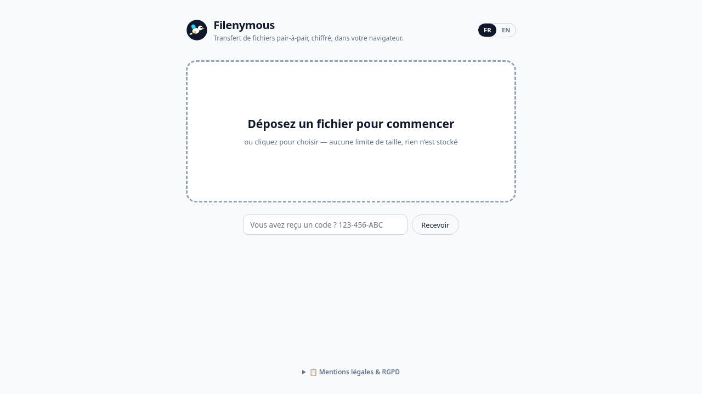
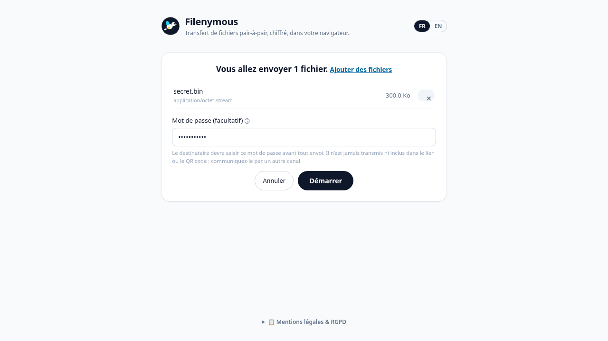
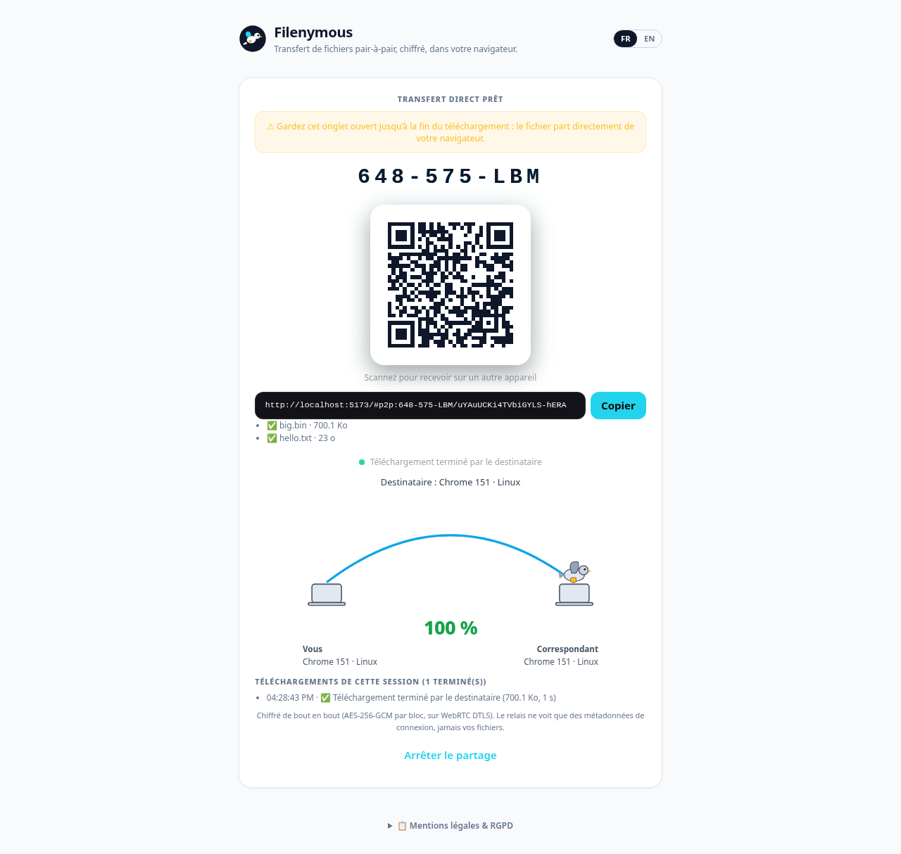
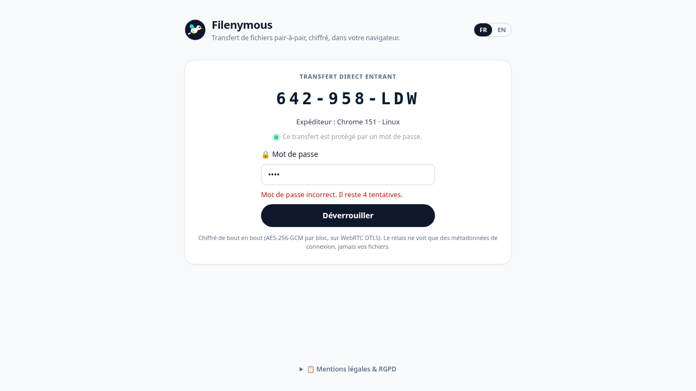

# Filenymous

**[English](#english) · [Français](#français)**

<p align="center">
  
  
</p>
<p align="center">
  
  
</p>

---

## English

### What it is

Filenymous is a **direct, browser-to-browser file transfer** web app in the style of [file.pizza](https://file.pizza). Drop a file, share a link, a code or a QR code, and the recipient downloads it straight from your browser over WebRTC. No account and no cloud storage. The file is encrypted end to end, and it only exists in the two browsers.

- **App:** https://filenymous.eu/app/
- **Landing page:** https://filenymous.eu/
- **Signaling relay (health):** https://www.opendpe.net/filenymous-signal/health

### Features

- **Single page, file.pizza flow:**
  1. Drop or pick files.
  2. Review them: list with MIME type and size, remove or add files, optional password.
  3. Click **Start** to get the link, the short code (`123-456-ABC`) and the QR code.
  4. The recipient opens the link, scans the QR code or types the code, then clicks **Download**.
- **End-to-end encryption:** every 64 KiB chunk is sealed with AES-256-GCM, on top of WebRTC DTLS. The key is derived with HKDF from a 128-bit secret that only lives in the URL fragment (`#p2p:CODE/SECRET`), which servers never see. A chunk that is reordered, swapped or tampered with fails to decrypt.
- **Optional password:**
  - The recipient must prove the password with an HMAC challenge-response over a PBKDF2-SHA256 key (310 000 iterations) before any file name or byte is sent.
  - The password never crosses the network, and it is never in the link or the QR code.
  - Half of the derived key is mixed into the AES file key, so the link alone cannot decrypt.
  - After 5 wrong attempts the share is locked.
- **Live progress on both sides:** an animated carrier pigeon flies from sender to receiver according to the bytes the recipient confirmed, and lands at 100 %. The sender also sees per-file delivery, speed, and the success or failure of each download in the session.
- **Peer device:** each side shows the other's browser and OS (e.g. `Chrome 129 · Windows ↔ Safari 17 · iPhone`). The user agent is parsed locally and exchanged only over the DataChannel.
- **Bilingual FR/EN** with a language switch.
- **Large files:** files are read with `File.slice()` and are never loaded whole into memory. Chromium writes them to disk as they arrive (File System Access API). Other browsers fall back to Blob downloads.
- **The sender keeps the tab open.** The share lasts as long as the tab, and several recipients can download one after the other.

The previous multi-panel UI (self-contained `#sl=` links, rooms, contacts…) is still reachable at `/app/#legacy`. It is no longer linked anywhere.

### Architecture

```
 sender browser ──WebRTC DataChannel (DTLS + AES-256-GCM chunks)──► receiver browser
        │                         ▲ (fallback: TURN relay, sees ciphertext only)
        └──── WebSocket signaling (SDP / ICE only) ──── p2p-signal ────┘
```

| Part | Where | What |
|---|---|---|
| UI | `ui/` (React 18 + Vite + TypeScript, i18next) | `src/pizza/` single-page shell, `src/p2p/` protocol, session, signaling client, sinks and UA parsing. |
| Signaling | `p2p-signal/server.js` (Node + `ws`, port 8789) | On a VPS behind nginx at `wss://www.opendpe.net/filenymous-signal/`. Relays only offers, answers and ICE candidates for a one-time code room. `GET /ice` returns STUN plus short-lived TURN credentials. Stores nothing. |
| TURN | coturn with `use-auth-secret` (TURN REST API) | Used only when a direct connection is impossible (strict NAT, corporate firewall). Credentials are per-request and valid for 1 h. The relay forwards encrypted bytes only. |
| Hosting | OVH shared hosting | Static build served at `https://filenymous.eu/app/`. |

Holochain-era parts (`dnas/`, `happ.yaml`, `web-happ.yaml`, `network/`, `push-server/`, `src-tauri/`, `filenymous-app.html`) are still built by CI and kept for reference. The direct P2P flow does not use them. Obsolete design notes are in `docs/archive/`.

### Development

```bash
cd ui
npm ci
npm run dev                 # http://localhost:5173
# local signaling relay (optional, otherwise the production relay is used)
cd ../p2p-signal && npm ci && npm start   # ws://127.0.0.1:8789
```

To point the dev UI at a local relay, set `window.__FILENYMOUS_SIGNAL_URL__ = "ws://127.0.0.1:8789"` before the app loads, as the e2e tests do.

### Build

```bash
cd ui
npm run build -- --base=/app/      # → ui/dist (served under /app/)
```

### Deployment

**UI (OVH, SFTP):** this merges into the remote folder and backs up each overwritten file to `<remote>.bak-<timestamp>/`. The password comes from the `OVH_SFTP_PASS` environment variable, so never commit it.

```bash
cd scripts && npm ci && cd ..
OVH_SFTP_PASS=… node scripts/deploy-ovh-sftp.mjs --dist ui/dist --remote /home/filenyb/www/app --merge
```

**Signal server (VPS):** see [`p2p-signal/README.md`](p2p-signal/README.md). In short:
1. Copy `server.js` and the package files to `/opt/filenymous-signal/app`, then run `npm ci --omit=dev`.
2. Install `filenymous-signal.service`, and keep `TURN_URLS`, `TURN_SECRET` and `ALLOWED_ORIGIN` in `/etc/filenymous-signal.env`. Set `TRUST_PROXY=1` behind nginx.
3. Use the nginx location from `p2p-signal/nginx-opendpe-location.conf`.
4. Check with `curl …/filenymous-signal/health` and `/ice`.

More history and checklists are in [`docs/DEPLOYMENT.md`](docs/DEPLOYMENT.md).

### Tests

```bash
cd ui
npx tsc --noEmit
npm test                         # vitest unit tests (protocol, password gate, UA parser, …)
npx playwright test              # e2e: two browser contexts + a local p2p-signal relay
cd ../tests && npm ci && npx vitest run src/p2p_signal_*.test.ts   # relay tests (run in CI)
```

The e2e suite covers transfers with no password, with a wrong then correct password, and the lockout after 5 attempts. It also covers a typed code, signaling reconnects, a recipient leaving mid-transfer, and the legacy `#legacy` link flow.

### Privacy & legal summary

- Files go **directly from browser to browser**, encrypted, and are never stored on a server. There is no file database.
- The **signaling server** temporarily sees the transfer code and network connection data (IP addresses, WebRTC parameters). Nothing is persisted.
- The **TURN relay**, when used, forwards bytes that are already encrypted. It cannot read them and stores nothing.
- The browser and OS name is exchanged only between the two peers.
- **No cookies, no analytics, no ads.** Closing the sender's tab ends the share. The decryption key exists only in the shared link, plus the password when one is set.

The full notice ("Mentions légales & RGPD") is in the app footer.

License: see [LICENSE](LICENSE).

---

## Français

### Qu'est-ce que c'est

Filenymous est une application web de **transfert de fichiers direct, de navigateur à navigateur**, sur le modèle de [file.pizza](https://file.pizza). On dépose un fichier, on partage un lien, un code ou un QR code, et le destinataire le télécharge directement depuis votre navigateur via WebRTC. Pas de compte, pas de stockage dans le cloud. Le fichier est chiffré de bout en bout et n'existe que dans les deux navigateurs.

- **Application :** https://filenymous.eu/app/
- **Page d'accueil :** https://filenymous.eu/
- **Relais de signalisation (santé) :** https://www.opendpe.net/filenymous-signal/health

### Fonctionnalités

- **Page unique, parcours file.pizza :**
  1. Déposer ou choisir des fichiers.
  2. Vérifier : liste avec type MIME et taille, retrait ou ajout de fichiers, mot de passe facultatif.
  3. Cliquer sur **Démarrer** pour obtenir le lien, le code court (`123-456-ABC`) et le QR code.
  4. Le destinataire ouvre le lien, scanne le QR code ou saisit le code, puis clique sur **Télécharger**.
- **Chiffrement de bout en bout :** chaque bloc de 64 Ko est chiffré en AES-256-GCM, en plus du DTLS de WebRTC. La clé est dérivée par HKDF d'un secret de 128 bits qui ne vit que dans le fragment de l'URL (`#p2p:CODE/SECRET`), jamais vu par les serveurs. Un bloc réordonné, échangé ou modifié ne se déchiffre pas.
- **Mot de passe facultatif :**
  - Le destinataire doit le prouver par un défi-réponse HMAC sur une clé PBKDF2-SHA256 (310 000 itérations), avant tout envoi de nom ou d'octet de fichier.
  - Le mot de passe ne circule jamais sur le réseau, et il n'est jamais dans le lien ni dans le QR code.
  - Une moitié de la clé dérivée entre dans la clé AES des fichiers : le lien seul ne suffit pas à déchiffrer.
  - Après 5 essais erronés, le partage est verrouillé.
- **Progression des deux côtés :** un pigeon voyageur animé vole de l'expéditeur au destinataire selon les octets confirmés, et se pose à 100 %. L'expéditeur voit aussi la livraison de chaque fichier, le débit, et le succès ou l'échec de chaque téléchargement de la session.
- **Appareil du correspondant :** chaque côté voit le navigateur et le système de l'autre (ex. `Chrome 129 · Windows ↔ Safari 17 · iPhone`). L'analyse se fait localement et l'information n'est échangée que par le canal de données.
- **Bilingue FR/EN** avec sélecteur de langue.
- **Gros fichiers :** lecture par `File.slice()`, sans charger le fichier entier en mémoire. Chromium écrit directement sur le disque (File System Access API), les autres navigateurs passent par un Blob.
- **L'expéditeur garde l'onglet ouvert :** le partage dure tant que l'onglet est ouvert, et plusieurs destinataires peuvent télécharger l'un après l'autre.

L'ancienne interface multi-panneaux (liens autonomes `#sl=`, salons, contacts…) reste accessible via `/app/#legacy`, mais elle n'est plus mise en avant.

### Architecture

| Élément | Où | Rôle |
|---|---|---|
| Interface | `ui/` (React 18 + Vite + TypeScript, i18next) | `src/pizza/` pour la page unique, `src/p2p/` pour le protocole, la session, le client de signalisation, l'écriture des fichiers et l'analyse du user agent. |
| Signalisation | `p2p-signal/server.js` (Node + `ws`, port 8789) | VPS derrière nginx, `wss://www.opendpe.net/filenymous-signal/`. Ne relaie que les offres, réponses et candidats ICE d'un salon à code unique. `GET /ice` fournit le STUN et des identifiants TURN éphémères. Ne stocke rien. |
| TURN | coturn en `use-auth-secret` (API REST TURN) | Utilisé seulement si la connexion directe est impossible. Identifiants par requête, valables 1 h. Le relais ne transmet que des octets chiffrés. |
| Hébergement | Hébergement mutualisé OVH | Build statique servi sur `https://filenymous.eu/app/`. |

Les éléments de l'ère Holochain (`dnas/`, `happ.yaml`, `web-happ.yaml`, `network/`, `push-server/`, `src-tauri/`, `filenymous-app.html`) sont toujours compilés par la CI et conservés pour référence. Le transfert P2P direct ne les utilise pas. Les notes de conception obsolètes sont dans `docs/archive/`.

### Développement, build, déploiement, tests

Les commandes sont les mêmes que dans la section anglaise :

- **Développement :** `cd ui && npm ci && npm run dev`.
- **Relais local (facultatif) :** `cd p2p-signal && npm ci && npm start`.
- **Build :** `npm run build -- --base=/app/`.
- **Déploiement de l'interface :** `node scripts/deploy-ovh-sftp.mjs --dist ui/dist --remote /home/filenyb/www/app --merge`. Le mot de passe est lu dans `OVH_SFTP_PASS` et ne doit jamais être commité.
- **Serveur de signalisation :** voir `p2p-signal/README.md`.
- **Tests :** `npx tsc --noEmit`, `npm test`, `npx playwright test`. Les tests e2e couvrent le transfert sans mot de passe, avec un mauvais puis le bon mot de passe, et le verrouillage après 5 essais.

### Confidentialité et mentions légales (résumé)

- Les fichiers vont **directement d'un navigateur à l'autre**, chiffrés, et ne sont jamais stockés sur un serveur.
- Le **serveur de signalisation** voit temporairement le code de transfert et les données de connexion réseau (adresses IP, paramètres WebRTC). Rien n'est conservé.
- Le **relais TURN**, s'il est utilisé, ne transmet que des octets déjà chiffrés. Il ne peut pas les lire et ne stocke rien.
- Le nom du navigateur et du système n'est échangé qu'entre les deux pairs.
- **Aucun cookie, aucune analytics, aucune publicité.** Fermer l'onglet de l'expéditeur met fin au partage.

Le texte complet (« Mentions légales & RGPD ») se trouve dans le pied de page de l'application.
