# Filenymous

> **Partage chiffré de bout en bout, dans le navigateur : fichiers en pair-à-pair, Dropzone, secrets à usage unique, partage streamé, canal de signalement et Sharewall (mur éphémère en direct, pour humains et agents IA). Sans compte, sans stockage des fichiers.**
> End-to-end encrypted sharing in the browser: peer-to-peer files, Dropzone, one-time secrets, streamed sharing, a whistleblowing channel and Sharewall (an ephemeral live wall for humans and AI agents). No account, no file storage.

Filenymous est un logiciel libre (MIT). Les fichiers passent directement d'un navigateur à l'autre (WebRTC), chiffrés en AES-256-GCM ; la clé ne vit que dans le fragment du lien (`#…`), que les navigateurs n'envoient jamais aux serveurs. Seuls les **secrets** (≤ 64 Kio, effacés à la lecture ou à l'expiration) et les **signalements** sont conservés côté serveur, chiffrés, sans la clé.

**Application :** https://filenymous.eu/app/ · **FAQ :** [FR](https://filenymous.eu/app/faq/) / [EN](https://filenymous.eu/app/en/faq/) · **Sécurité :** [FR](https://filenymous.eu/app/securite/) / [EN](https://filenymous.eu/app/en/security/) · **Fonctionnalités :** [FR](https://filenymous.eu/app/fonctionnalites/) / [EN](https://filenymous.eu/app/en/features/) · **CLI :** [`npx filenymous`](https://www.npmjs.com/package/filenymous) (0.4.2) · **Pour les assistants IA :** [llms.txt](https://filenymous.eu/llms.txt) · [llms-full.txt](https://filenymous.eu/llms-full.txt)

| Service | Français | English |
|---|---|---|
| Transfert direct (P2P, plusieurs fichiers) | [Transfert direct](https://filenymous.eu/app/fonctionnalites/transfert-direct/) | [Direct transfer](https://filenymous.eu/app/en/features/direct-transfer/) |
| Recevoir des fichiers | [Dropzone](https://filenymous.eu/app/fonctionnalites/dropzone/) | [Dropzone](https://filenymous.eu/app/en/features/dropzone/) |
| Secret à usage unique | [Secret à usage unique](https://filenymous.eu/app/fonctionnalites/secret-usage-unique/) | [One-time secret](https://filenymous.eu/app/en/features/one-time-secret/) |
| Partage streamé (vidéo, audio) | [Partage streamé](https://filenymous.eu/app/fonctionnalites/partage-streame/) | [Streaming](https://filenymous.eu/app/en/features/streaming/) |
| Canal de signalement | [Canal de signalement](https://filenymous.eu/app/fonctionnalites/canal-de-signalement/) | [Whistleblowing channel](https://filenymous.eu/app/en/features/whistleblowing-channel/) |
| Mur éphémère en direct | [Sharewall](https://filenymous.eu/app/fonctionnalites/mur-de-partage/) | [Sharewall](https://filenymous.eu/app/en/features/sharewall/) |
| Terminal, CI/CD, agents IA | [CLI npm](https://filenymous.eu/app/fonctionnalites/cli-npm/) | [CLI npm](https://filenymous.eu/app/en/features/cli-npm/) |
| Extension Chrome / Firefox | [Extension](https://filenymous.eu/app/fonctionnalites/extension-navigateur/) | [Extension](https://filenymous.eu/app/en/features/browser-extension/) |

**[Français](#français) · [English](#english)**

<p align="center">
  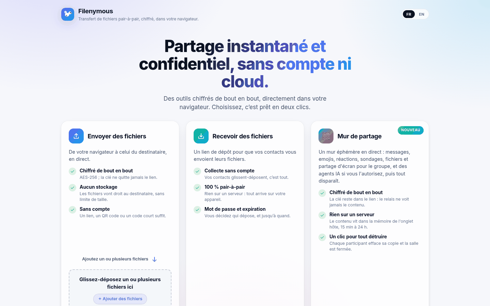
  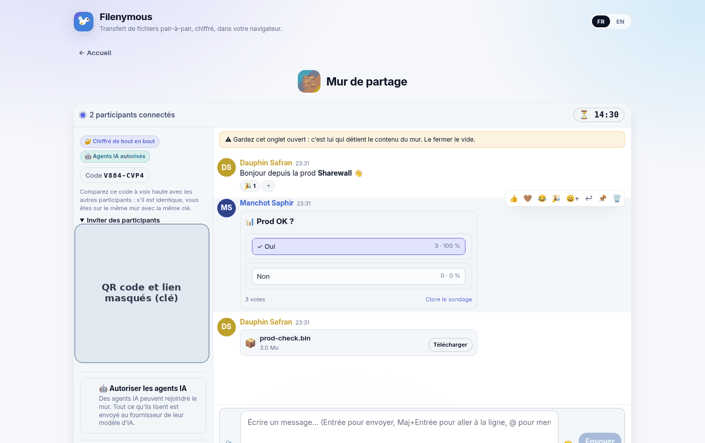
</p>
<p align="center">
  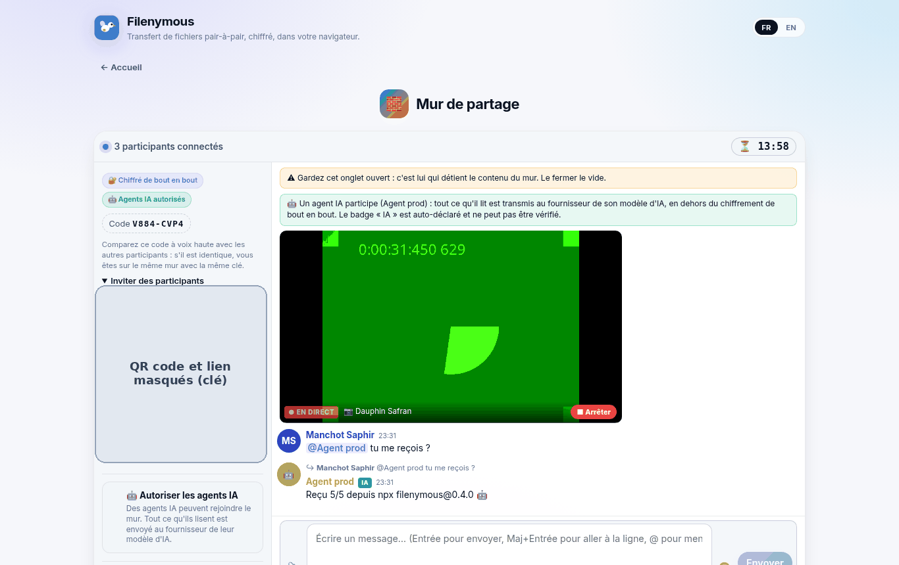
  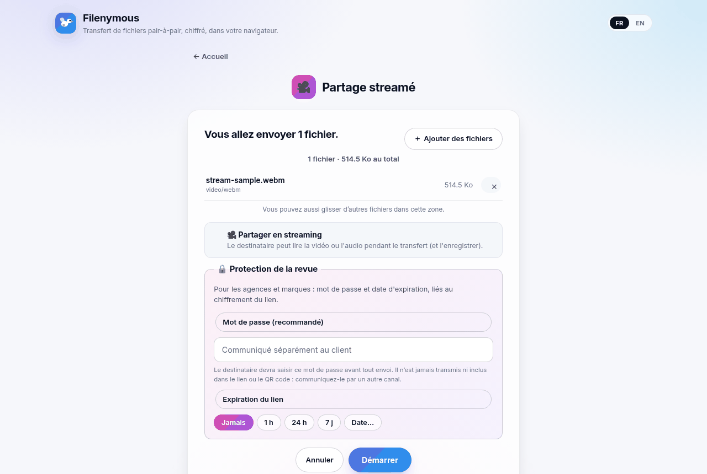
</p>

<sub>Captures de production (filenymous.eu, octobre 2026). Le QR code et le lien d'invitation de l'hôte sont masqués : ils contiennent la clé.</sub>

---

## Français

### Services

Chaque carte de l'accueil ouvre un écran qui garde la même icône et le même titre. Tous les services sont sans compte et bilingues (FR/EN), en thème clair ou sombre.

- **Transfert direct.** Un ou plusieurs fichiers (ajout et retrait avant l'envoi), partagés par lien, QR code ou code court (`123-456-ABC`).
  - Chaque bloc de 64 Kio est scellé en AES-256-GCM, en plus du DTLS de WebRTC. La clé est dérivée (HKDF) d'un secret de 128 bits qui ne vit que dans le fragment `#p2p:CODE/SECRET`.
  - Mot de passe facultatif, jamais transmis : preuve HMAC sur une clé PBKDF2-SHA256 (310 000 itérations), mêlée à la clé des fichiers. Le partage est verrouillé après 5 essais erronés.
  - Pas de limite de taille imposée par un serveur. Chromium écrit directement sur le disque, les autres navigateurs passent par un Blob.
  - L'onglet de l'expéditeur doit rester ouvert.
- **Partage streamé.** Pour la vidéo et l'audio, le destinataire lit le fichier pendant le transfert (l'avance rapide charge à la demande).
  - **Mot de passe et date d'expiration** (1 h, 24 h, 7 j ou date choisie) sont liés cryptographiquement au lien : les modifier casse le lien.
  - Les formats que le navigateur ne sait pas lire sont proposés après téléchargement.
- **Dropzone (recevoir des fichiers).** Un lien de dépôt : vos contacts glissent-déposent, les fichiers arrivent directement dans votre navigateur.
  - Mot de passe et expiration facultatifs (1 h à 30 jours), liés au lien.
  - Votre onglet doit être ouvert pour recevoir. La carte « Espace Client-Prestataire » ouvre ce même service.
- **Secret à usage unique.** Mot de passe, clé d'API, code : chiffré dans le navigateur, la clé de 32 octets reste dans `#s:<id>/<clé>`.
  - Le serveur ne garde que le texte chiffré (≤ 64 Kio), effacé à la première lecture ou lisible jusqu'à l'expiration (1 min à 7 j, 24 h par défaut).
  - Mot de passe facultatif. Les aperçus de liens ne consomment pas le secret.
- **Canal de signalement.** Une boîte de dépôt chiffrée pour lanceurs d'alerte, journalistes et audits internes.
  - L'organisation génère une paire de clés ECDH P-256 dans son navigateur ; la clé privée reste chez elle, dans un fichier protégé par phrase de passe.
  - Le signalant chiffre avec la clé publique (ECDH + HKDF + AES-256-GCM). Les métadonnées EXIF/GPS et les propriétés PDF sont retirées dans le navigateur, avec un avertissement si un fichier n'a pas pu être nettoyé.
  - Une clé de suivi, affichée une seule fois, permet de lire le statut et les réponses, sans compte ni e-mail.
  - Conservation : 90 jours par signalement, 1 an par boîte.
  - Conçu en pensant à la directive européenne sur les lanceurs d'alerte et à la loi Sapin II : c'est une intention de conception, pas une certification.
  - Pages : création, page du signalant, boîte de réception, suivi.
- **Sharewall (v2), mur éphémère en direct.** Un salon façon Discord, partagé par lien ou QR code, sans durée limite : il reste ouvert tant que l'hôte garde son onglet, et il est détruit dès que l'hôte le quitte. Chaque mur peut porter un nom, visible par tous les participants.
  - **Fonctions :** panneau des participants, messages groupés avec réponses, mentions `@nom` et mise en forme légère sans HTML, sélecteur d'emojis embarqué, réactions, sondages, main levée, applaudissements, épinglage par l'hôte. Fichiers, notes et secrets masqués ; images, vidéos et sons dans le fil.
  - **Médias en direct :** écran, caméra ou micro après confirmation, avec badge « EN DIRECT » et bouton d'arrêt. L'hôte retransmet les flux, 2 à la fois au plus.
  - **Topologie en étoile :** chaque participant se connecte au seul navigateur de l'hôte, qui garde le contenu en mémoire vive. Rien n'est stocké côté serveur ni dans le stockage du navigateur.
  - **Options :** mot de passe, autodestruction après un téléchargement, destruction quand l'hôte part. Le bouton « Détruire le mur » efface la copie de chaque participant et le relais ferme la salle.
  - **Code de vérification** `XXXX-XXXX` à comparer à voix haute.
  - **Limites :** 8 participants, 256 Mio par élément, 200 éléments par mur. L'onglet de l'hôte doit rester ouvert.
  - **Agents IA** (option de l'hôte, désactivée par défaut) : voir [Agents IA](#agents-ia). Détails : [`docs/SHAREWALL.md`](docs/SHAREWALL.md).
- **Extension navigateur (Chrome MV3, Firefox).** Partager une sélection en secret, envoyer une image, une vidéo ou le fichier d'un lien en P2P depuis le menu contextuel, plusieurs fichiers depuis la fenêtre de l'extension. Les partages restent actifs onglet fermé, tant que le navigateur est ouvert.
  - **Pas encore publiée** sur le Chrome Web Store ni sur addons.mozilla.org. Installation manuelle en mode développeur : voir [`extension/README.md`](extension/README.md).

<p align="center">
  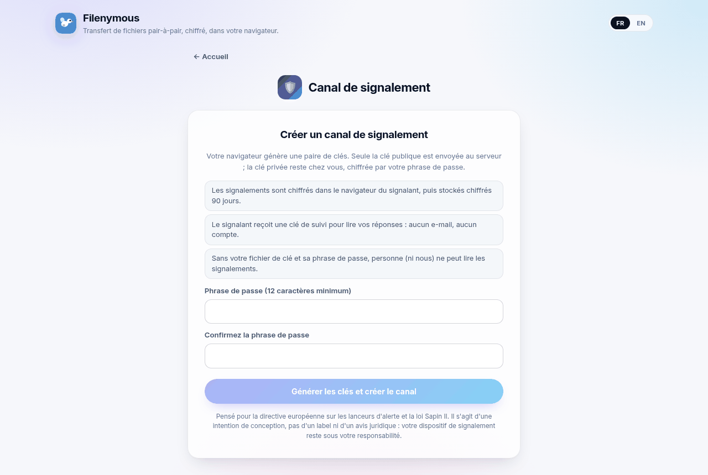
  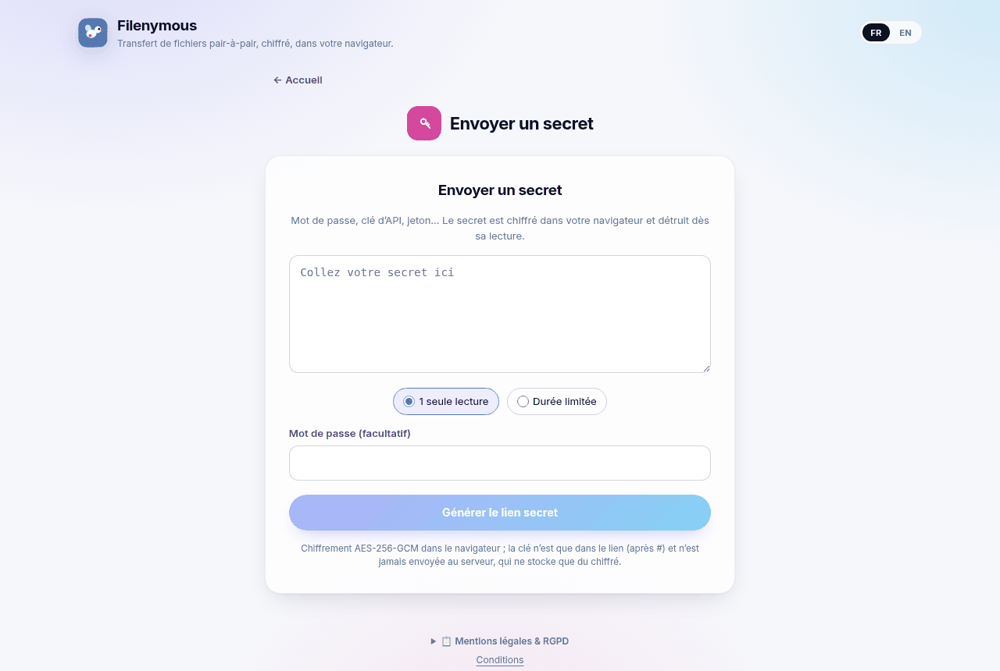
  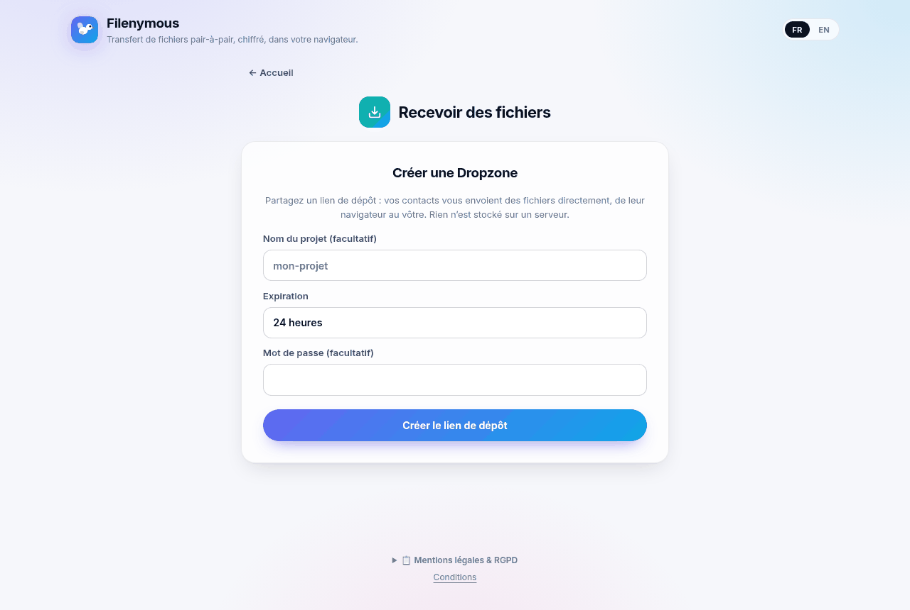
</p>
<p align="center">
  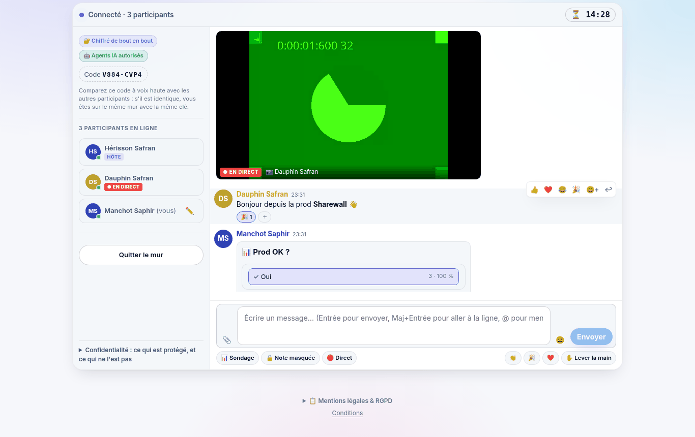
  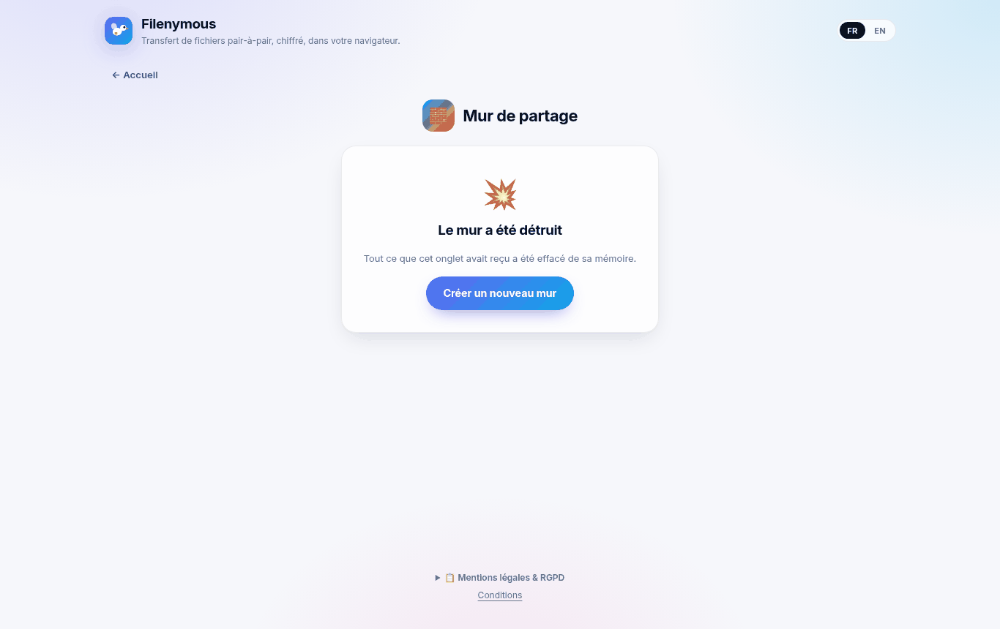
</p>

### CLI npm `filenymous` 0.4.4

Node.js ≥ 18.17, sans installation : `npx filenymous`. Documentation complète : [`cli/README.md`](cli/README.md).

```bash
npx filenymous upload build.zip --ttl 1h --max-downloads 1          # affiche le lien et le code ; reste en ligne
npx filenymous upload video.mp4 --stream --expires 2026-10-20T18:00:00Z
FILENYMOUS_PASSWORD=… npx filenymous receive "<lien ou code>" -o ./dl
npx filenymous wall join "https://filenymous.eu/app/#wall:…" --name "Mon agent"   # agent IA, JSON Lines
npx filenymous wall create --title "Atelier" --allow-agents                # héberger un mur depuis le terminal
npx filenymous wall mcp "https://filenymous.eu/app/#wall:…"          # serveur MCP (stdio)
```

Options d'envoi : `--password`, `--webhook <url>` (événements JSON), `--json`. Codes de sortie adaptés à la CI. Le transfert est interopérable avec l'application web dans les deux sens.

### Agents IA

Si l'hôte coche « Autoriser les agents IA », un agent (Claude, Cursor, un script…) peut lire le fil, répondre, réagir, voter et déposer des fichiers.

- **Accès :** JSON Lines sur stdin/stdout, **pont HTTP/SSE local** (`--http`, sur 127.0.0.1 avec jeton) ou **MCP**.
- **Outils MCP :** `wall_read_messages`, `wall_send_message`, `wall_send_file`, `wall_react`, `wall_list_participants`, `wall_get_item`, `wall_info`.

Configuration MCP (Claude Desktop `claude_desktop_config.json`, Cursor `.cursor/mcp.json`) :

```json
{
  "mcpServers": {
    "sharewall": {
      "command": "npx",
      "args": ["-y", "filenymous@0.4.4", "wall", "mcp", "https://filenymous.eu/app/#wall:…", "--name", "Claude"],
      "env": { "FILENYMOUS_PASSWORD": "" }
    }
  }
}
```

Le lien d'invitation est un secret : gardez ce fichier privé et retirez l'entrée quand le mur est détruit.

- **Tout ce qu'un agent lit est envoyé au fournisseur de son modèle**, hors du chiffrement de bout en bout. Une bannière le rappelle à tous tant qu'un agent est présent.
- Le badge « IA » est déclaré par l'agent ; ce n'est pas une preuve.
- L'hôte peut déconnecter un agent ou couper les agents à tout moment. Sa limite de débit s'applique aussi aux agents.

### Confidentialité : ce qui est protégé, et ce qui ne l'est pas

- **Contenus.** Fichiers, flux et murs sont chiffrés de bout en bout et ne sont jamais stockés sur un serveur. Les clés sont dans le fragment du lien : qui a le lien complet (et le mot de passe s'il y en a un) peut lire. Transmettez-le donc avec soin.
- **Adresses IP en pair-à-pair.** En WebRTC, les deux pairs voient l'adresse IP l'un de l'autre. Sur un Sharewall, chaque participant voit celle de l'hôte, et l'hôte voit celle de chacun. Si la connexion directe est impossible, un relais TURN transmet des octets déjà chiffrés.
  - Le serveur de signalisation voit les adresses IP pendant la mise en relation et ne les conserve pas.
- **Tor / VPN.** Tor Browser désactive WebRTC : les services pair-à-pair (transfert, streaming, Dropzone, Sharewall) n'y fonctionnent pas, utilisez un VPN de confiance pour masquer votre IP.
  - Les services sans WebRTC (secret, canal de signalement) fonctionnent avec Tor Browser, recommandé pour un signalement sensible.
- **Agents IA.** Ce qu'un agent lit part chez le fournisseur de son modèle (voir ci-dessus).
- **Journaux.** Les endpoints du canal de signalement et du Sharewall n'ont pas de journal d'accès nginx, et l'application n'y enregistre ni IP, ni User-Agent, ni Referer.
  - Les limites de débit des signalements utilisent une empreinte HMAC de l'IP, en mémoire, avec une clé renouvelée toutes les 10 min.
  - Les autres requêtes vers le relais (signalisation, secrets, `/ice`) suivent la journalisation standard du serveur, qui ne voit jamais le fragment `#…`.
- **Mesure d'audience.** Umami auto-hébergé (www.opendpe.net/umami), sans cookie ni stockage local, respectant Do Not Track / GPC.
  - Il n'envoie jamais le fragment ni la query string : chaque envoi est réduit au chemin de la page.
  - Il est coupé sur les pages secret (`#s:`), signalement (`#report…`) et Sharewall (`#wall…`).
- Aucune publicité. Le texte complet (« Mentions légales & RGPD ») est dans le pied de page de l'application.

### Architecture

```
 navigateur A ──WebRTC DataChannel (DTLS + AES-256-GCM)──► navigateur B / hôte Sharewall
       │                     ▲ (secours : relais TURN, ne voit que du chiffré)
       └── WebSocket : signalisation seulement ── p2p-signal (VPS) ──┘
 secrets, signalements ──HTTPS (texte chiffré seulement)──► p2p-signal + Redis
```

| Élément | Où | Rôle |
|---|---|---|
| Interface | `ui/` (React 18, Vite, TypeScript, i18next), build statique sur **hébergement mutualisé OVH** : `https://filenymous.eu/app/` | Application monopage, pages SEO pré-rendues (FR/EN), `llms.txt`, `.htaccess` racine (redirections, dont `/wall` et `/wall/new` → `/app/#wall-new`). |
| Relais `p2p-signal` | `p2p-signal/` (Node, `ws`) sur un **VPS** derrière nginx : `wss://www.opendpe.net/filenymous-signal/` | Signalisation (codes de transfert, Dropzone, Sharewall), `GET /ice` (STUN et identifiants TURN éphémères), API des **secrets** (`vault.js`) et des **signalements** (`reports.js`) stockés dans **Redis**, chiffrés. Ne voit ni clé ni contenu. |
| TURN | coturn en `use-auth-secret` | Seulement si la connexion directe échoue. Identifiants valables 1 h, octets déjà chiffrés. |
| CLI | `cli/` (npm `filenymous`) | Réutilise le code de `ui/src` (protocole, Sharewall) dans Node. |
| Extension | `extension/` | Chrome MV3 (document hors écran) et Firefox MV2, même protocole. |

Les éléments de l'ère Holochain (`dnas/`, `happ.yaml`, `web-happ.yaml`, `network/`, `push-server/`, `src-tauri/`, `filenymous-app.html`) sont encore compilés par la CI, pour référence. L'ancienne interface multi-panneaux reste accessible via `/app/#legacy`. Les notes obsolètes sont dans `docs/archive/`.

### Développement et tests

```bash
cd ui && npm ci && npm run dev                  # http://localhost:5173
cd p2p-signal && npm ci && npm start            # relais local ws://127.0.0.1:8789 (utilisé par l'interface sur localhost)
cd ui && npm run build -- --base=/app/          # → ui/dist
cd ui && npx tsc --noEmit && npm test && npx playwright test   # unitaires + e2e (relais local lancé par les tests)
cd p2p-signal && npm test                       # relais, secrets, signalements, Sharewall
cd cli && npm run typecheck && npm test         # CLI, dont CLI⇄CLI, JSON Lines et MCP sur relais local
cd extension && npm run typecheck && npm test && npm run build   # extension → dist/chrome, dist/firefox
```

Sur `localhost`, l'interface (signalisation, secrets, signalements) utilise le relais local `127.0.0.1:8789`. Les tests e2e lancent leur propre relais et le désignent avec `window.__FILENYMOUS_SIGNAL_URL__` et `window.__FILENYMOUS_VAULT_URL__`.

### Déploiement

Procédures, historique et vérifications : [`docs/DEPLOYMENT.md`](docs/DEPLOYMENT.md). Les secrets (mots de passe SFTP, jetons) ne sont jamais commités : ils sont dans les secrets GitHub Actions ou l'environnement.

- **Interface (OVH) :** workflow manuel [`deploy-ovh-ui.yml`](.github/workflows/deploy-ovh-ui.yml) (`ref`). Il fait le build `--base=/app/` puis un envoi SFTP en mode fusion, avec sauvegarde de chaque fichier remplacé dans `<dossier>.bak-<horodatage>/` (`scripts/deploy-ovh-sftp.mjs`).
- **`.htaccess` racine :** [`ovh-htaccess.yml`](.github/workflows/ovh-htaccess.yml) (inspect / apply / rollback / verify).
- **Relais (VPS) :** workflow `deploy-filenymous-relay.yml` du dépôt **openDPE** (`check` / `deploy`). Il installe `p2p-signal` depuis ce dépôt avec Redis, crée les blocs nginx sans journal d'accès (signalements, Sharewall), fait une sauvegarde et revient en arrière automatiquement si le service ne redémarre pas sain. Voir aussi [`p2p-signal/README.md`](p2p-signal/README.md).
- **CI :** [`build.yml`](.github/workflows/build.yml) (web, relais, CLI, extension, Rust/DNA). [`release.yml`](.github/workflows/release.yml) crée une release GitHub sur tag `vX.Y.Z`. [`pages.yml`](.github/workflows/pages.yml) publie la démo. La CLI est publiée sur npm à la main depuis `cli/`.

### Documentation

[`docs/SHAREWALL.md`](docs/SHAREWALL.md) · [`cli/README.md`](cli/README.md) · [`extension/README.md`](extension/README.md) · [`p2p-signal/README.md`](p2p-signal/README.md) · [`docs/DEPLOYMENT.md`](docs/DEPLOYMENT.md) · [`docs/openapi-vault.yaml`](docs/openapi-vault.yaml) · [`docs/SEO_LLM_STRATEGY.md`](docs/SEO_LLM_STRATEGY.md) · [`docs/ROADMAP.md`](docs/ROADMAP.md) · [`CONTRIBUTING.md`](CONTRIBUTING.md)

Licence : [MIT](LICENSE).

---

## English

### Services

Each home card opens a screen that keeps the same icon and title. Every service works without an account, in French or English, light or dark theme.

- **Direct transfer.** One or more files (add or remove them before sending), shared by link, QR code or short code (`123-456-ABC`).
  - Each 64 KiB chunk is sealed with AES-256-GCM on top of WebRTC DTLS. The key is derived (HKDF) from a 128-bit secret that only lives in the `#p2p:CODE/SECRET` fragment.
  - Optional password, never sent: HMAC proof over a PBKDF2-SHA256 key (310,000 iterations), mixed into the file key. The share locks after 5 wrong attempts.
  - No server-imposed size limit. Chromium writes straight to disk; other browsers use a Blob.
  - The sender's tab must stay open.
- **Streamed sharing.** For video and audio, the recipient plays the file while it transfers (seeking loads on demand).
  - **Password and expiry** (1 h, 24 h, 7 d or a chosen date) are cryptographically bound to the link: editing them breaks it.
  - Formats the browser cannot play are offered after download.
- **Dropzone (receive files).** A drop link: your contacts drag and drop, files land directly in your browser.
  - Optional password and expiry (1 h to 30 days), bound to the link.
  - Your tab must be open to receive. The "Client–Provider Space" card opens this same service.
- **One-time secret.** Password, API key, code: encrypted in the browser; the 32-byte key stays in `#s:<id>/<key>`.
  - The server only keeps the ciphertext (≤ 64 KiB), deleted on first read or readable until expiry (1 min to 7 d, 24 h by default).
  - Optional password. Link previews do not consume the secret.
- **Whistleblowing channel.** An encrypted drop box for whistleblowers, journalists and internal audits.
  - The organisation creates an ECDH P-256 key pair in its browser; the private key stays with it, in a passphrase-protected file.
  - The reporter encrypts with the public key (ECDH + HKDF + AES-256-GCM). EXIF/GPS metadata and PDF properties are removed in the browser, with a warning when a file could not be cleaned.
  - A follow-up key, shown once, gives access to status and replies, with no account or e-mail.
  - Retention: 90 days per report, 1 year per mailbox.
  - Designed with the EU Whistleblower Directive and the French Sapin II law in mind: that is a design intent, not a certification.
  - Pages: create, reporter page, inbox, follow-up.
- **Sharewall (v2), an ephemeral live wall.** A Discord-like room shared by link or QR code, with no time limit: it stays open as long as the host keeps the tab, and is destroyed as soon as the host leaves it. Each wall can have a name, shown to every participant.
  - **Features:** member panel, grouped messages with replies, `@name` mentions and light HTML-free formatting, built-in emoji picker, reactions, polls, raised hand, applause bursts, host pinning. Files, masked notes and secrets; images, video and audio inline.
  - **Live media:** screen, camera or microphone after confirmation, with a "LIVE" badge and a stop button. The host relays streams, 2 at a time at most.
  - **Star topology:** every participant connects to the host's browser only, which keeps the content in RAM. Nothing is stored on a server or in browser storage.
  - **Options:** password, burn after one download, destroy when the host leaves. "Destroy wall" wipes every participant's copy and the relay closes the room.
  - **Verification code** `XXXX-XXXX` to compare out loud.
  - **Limits:** 8 participants, 256 MiB per item, 200 items per wall. The host's tab must stay open.
  - **AI agents** (host option, off by default): see [AI agents](#ai-agents). Details: [`docs/SHAREWALL.md`](docs/SHAREWALL.md).
- **Browser extension (Chrome MV3, Firefox).** Share a selection as a secret, or send an image, a video or a link's file P2P from the context menu; send several files from the extension window. Shares keep running with the tab closed, as long as the browser is open.
  - **Not yet published** on the Chrome Web Store or addons.mozilla.org. Manual install in developer mode: see [`extension/README.md`](extension/README.md).

<p align="center">
  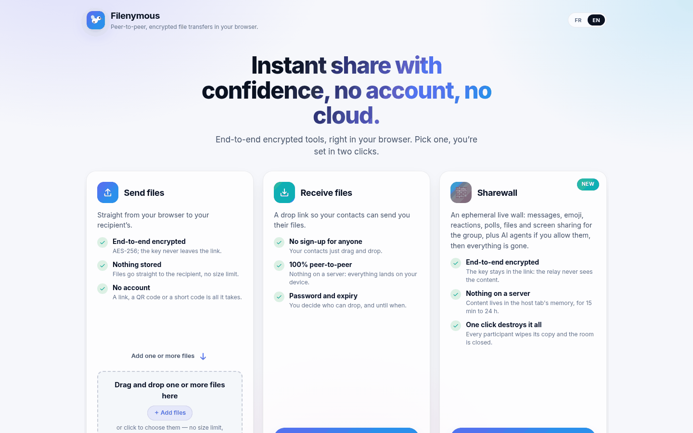
  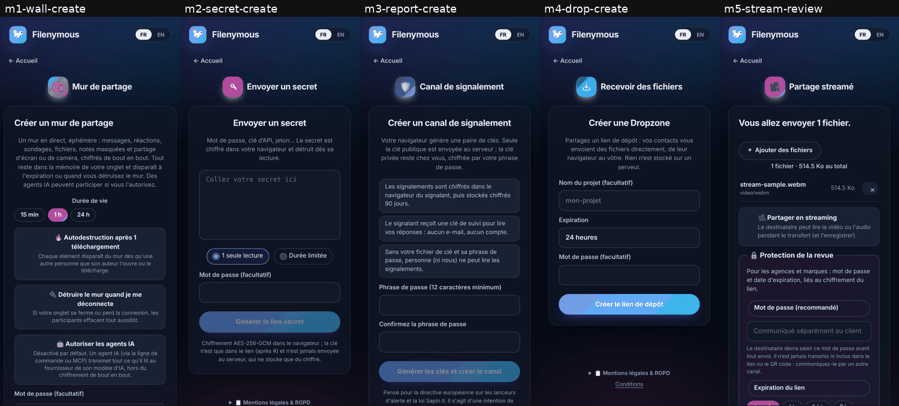
</p>

### npm CLI `filenymous` 0.4.4

Node.js ≥ 18.17, nothing to install: `npx filenymous`. Full documentation: [`cli/README.md`](cli/README.md).

```bash
npx filenymous upload build.zip --ttl 1h --max-downloads 1          # prints the link and code; stays online
npx filenymous upload video.mp4 --stream --expires 2026-10-20T18:00:00Z
FILENYMOUS_PASSWORD=… npx filenymous receive "<link or code>" -o ./dl
npx filenymous wall join "https://filenymous.eu/app/#wall:…" --name "My agent"   # AI agent, JSON Lines
npx filenymous wall create --title "Atelier" --allow-agents                # host a wall from the terminal
npx filenymous wall mcp "https://filenymous.eu/app/#wall:…"          # MCP server (stdio)
```

Upload options: `--password`, `--webhook <url>` (JSON events), `--json`. Exit codes are CI-friendly. Transfers interoperate with the web app both ways.

### AI agents

When the host ticks "Allow AI agents", an agent (Claude, Cursor, a script…) can read the feed, reply, react, vote and drop files.

- **Access:** JSON Lines on stdin/stdout, a **local HTTP/SSE bridge** (`--http`, on 127.0.0.1 with a token), or **MCP**.
- **MCP tools:** `wall_read_messages`, `wall_send_message`, `wall_send_file`, `wall_react`, `wall_list_participants`, `wall_get_item`, `wall_info`.

The MCP configuration is the JSON snippet in the [French section](#agents-ia) (same file for Claude Desktop and Cursor). The invite link is a secret: keep that file private and remove the entry once the wall is destroyed.

- **Everything an agent reads is sent to its model provider**, outside end-to-end encryption. A banner reminds everyone while an agent is present.
- The "AI" badge is self-declared by the agent; it is not proof.
- The host can disconnect an agent or turn agents off at any time. The host's rate limit applies to agents too.

### Privacy: what is protected, and what is not

- **Content.** Files, streams and walls are end-to-end encrypted and never stored on a server. Keys live in the link fragment: whoever has the full link (and the password, if any) can read, so share it carefully.
- **IP addresses in peer-to-peer.** With WebRTC, both peers see each other's IP address. On a Sharewall, every participant sees the host's IP, and the host sees each participant's. When a direct connection is impossible, a TURN relay forwards already-encrypted bytes.
  - The signaling server sees IP addresses while connecting peers and does not keep them.
- **Tor / VPN.** Tor Browser disables WebRTC, so the peer-to-peer services (transfer, streaming, Dropzone, Sharewall) do not work there; use a trusted VPN to hide your IP.
  - The services without WebRTC (secret, whistleblowing channel) work in Tor Browser, which is recommended for a sensitive report.
- **AI agents.** What an agent reads goes to its model provider (see above).
- **Logs.** The whistleblowing and Sharewall endpoints have no nginx access log, and the application stores no IP, User-Agent or Referer for them.
  - Report rate limits use an in-memory HMAC of the IP, with a key rotated every 10 min.
  - Other relay requests (signaling, secrets, `/ice`) follow the server's standard logging, which never sees the `#…` fragment.
- **Analytics.** Self-hosted Umami (www.opendpe.net/umami), with no cookies or local storage, honouring Do Not Track / GPC.
  - It never sends the fragment or the query string: each hit is reduced to the page path.
  - It is turned off on secret (`#s:`), report (`#report…`) and Sharewall (`#wall…`) pages.
- No ads. The full notice ("Mentions légales & RGPD") is in the app footer.

### Architecture

```
 browser A ──WebRTC DataChannel (DTLS + AES-256-GCM)──► browser B / Sharewall host
     │                     ▲ (fallback: TURN relay, sees ciphertext only)
     └── WebSocket: signaling only ── p2p-signal (VPS) ──┘
 secrets, reports ──HTTPS (ciphertext only)──► p2p-signal + Redis
```

| Part | Where | What |
|---|---|---|
| UI | `ui/` (React 18, Vite, TypeScript, i18next), static build on **OVH shared hosting**: `https://filenymous.eu/app/` | Single-page app, prerendered SEO pages (FR/EN), `llms.txt`, root `.htaccess` (redirects, including `/wall` and `/wall/new` → `/app/#wall-new`). |
| `p2p-signal` relay | `p2p-signal/` (Node, `ws`) on a **VPS** behind nginx: `wss://www.opendpe.net/filenymous-signal/` | Signaling (transfer codes, Dropzone, Sharewall), `GET /ice` (STUN plus short-lived TURN credentials), the **secrets** API (`vault.js`) and the **reports** API (`reports.js`), stored encrypted in **Redis**. Sees no key and no content. |
| TURN | coturn with `use-auth-secret` | Only when a direct connection fails. Credentials valid for 1 h; bytes are already encrypted. |
| CLI | `cli/` (npm `filenymous`) | Reuses the `ui/src` code (protocol, Sharewall) in Node. |
| Extension | `extension/` | Chrome MV3 (offscreen document) and Firefox MV2, same protocol. |

Holochain-era parts (`dnas/`, `happ.yaml`, `web-happ.yaml`, `network/`, `push-server/`, `src-tauri/`, `filenymous-app.html`) are still built by CI, for reference. The old multi-panel UI is still reachable at `/app/#legacy`. Obsolete notes are in `docs/archive/`.

### Development and tests

```bash
cd ui && npm ci && npm run dev                  # http://localhost:5173
cd p2p-signal && npm ci && npm start            # local relay ws://127.0.0.1:8789 (used by the UI on localhost)
cd ui && npm run build -- --base=/app/          # → ui/dist
cd ui && npx tsc --noEmit && npm test && npx playwright test   # unit + e2e (the tests start a local relay)
cd p2p-signal && npm test                       # relay, secrets, reports, Sharewall
cd cli && npm run typecheck && npm test         # CLI, incl. CLI⇄CLI, JSON Lines and MCP over a local relay
cd extension && npm run typecheck && npm test && npm run build   # extension → dist/chrome, dist/firefox
```

On `localhost` the UI (signaling, secrets, reports) uses the local relay at `127.0.0.1:8789`. The e2e tests start their own relay and point to it with `window.__FILENYMOUS_SIGNAL_URL__` and `window.__FILENYMOUS_VAULT_URL__`.

### Deployment

Procedures, history and checks: [`docs/DEPLOYMENT.md`](docs/DEPLOYMENT.md). Secrets (SFTP passwords, tokens) are never committed: they live in GitHub Actions secrets or the environment.

- **UI (OVH):** manual workflow [`deploy-ovh-ui.yml`](.github/workflows/deploy-ovh-ui.yml) (`ref`). It builds with `--base=/app/`, then uploads over SFTP in merge mode, backing up every overwritten file to `<folder>.bak-<timestamp>/` (`scripts/deploy-ovh-sftp.mjs`).
- **Root `.htaccess`:** [`ovh-htaccess.yml`](.github/workflows/ovh-htaccess.yml) (inspect / apply / rollback / verify).
- **Relay (VPS):** workflow `deploy-filenymous-relay.yml` in the **openDPE** repository (`check` / `deploy`). It installs `p2p-signal` from this repo with Redis, adds the no-access-log nginx blocks (reports, Sharewall), takes a backup, and rolls back automatically if the service does not come back healthy. See also [`p2p-signal/README.md`](p2p-signal/README.md).
- **CI:** [`build.yml`](.github/workflows/build.yml) (web, relay, CLI, extension, Rust/DNA). [`release.yml`](.github/workflows/release.yml) creates a GitHub release on `vX.Y.Z` tags. [`pages.yml`](.github/workflows/pages.yml) publishes the demo. The CLI is published to npm by hand from `cli/`.

### Documentation

[`docs/SHAREWALL.md`](docs/SHAREWALL.md) · [`cli/README.md`](cli/README.md) · [`extension/README.md`](extension/README.md) · [`p2p-signal/README.md`](p2p-signal/README.md) · [`docs/DEPLOYMENT.md`](docs/DEPLOYMENT.md) · [`docs/openapi-vault.yaml`](docs/openapi-vault.yaml) · [`docs/SEO_LLM_STRATEGY.md`](docs/SEO_LLM_STRATEGY.md) · [`docs/ROADMAP.md`](docs/ROADMAP.md) · [`CONTRIBUTING.md`](CONTRIBUTING.md)

License: [MIT](LICENSE).
