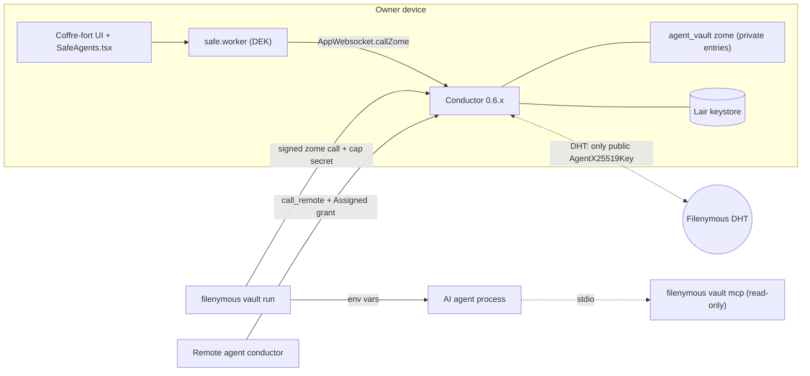
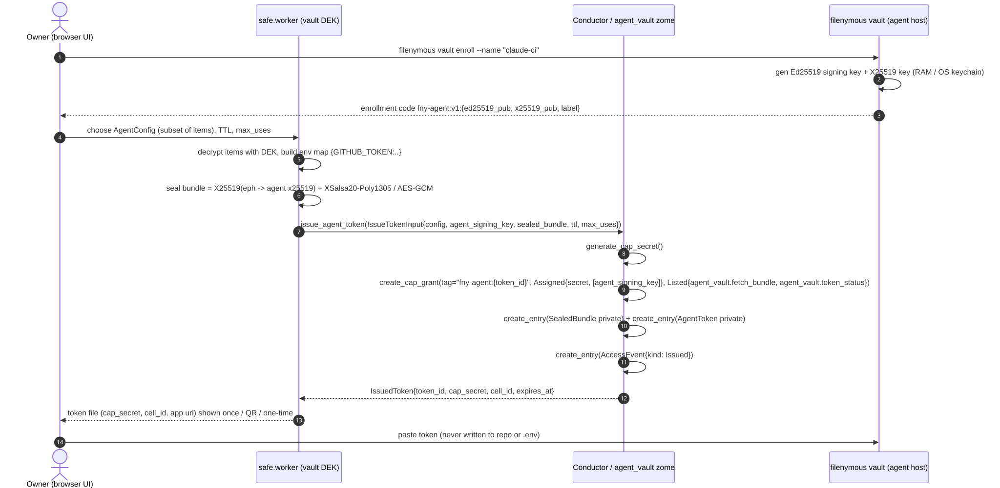
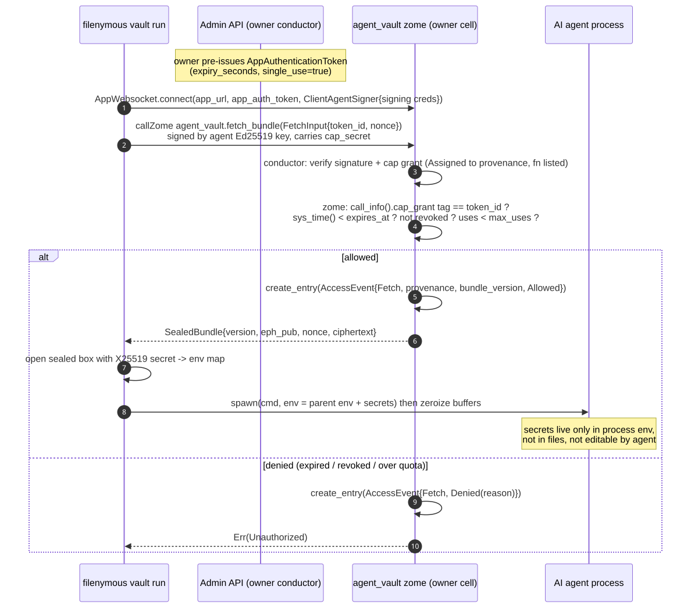
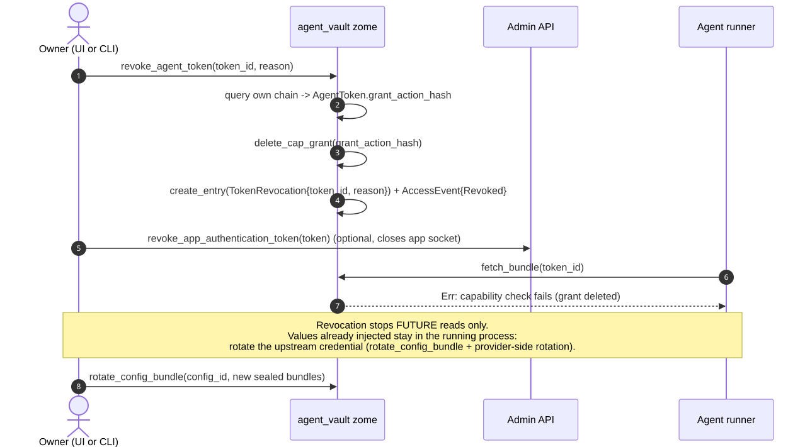

# Filenymous Agent Vault — Doppler-style "secrets for AI agents" on Holochain P2P

> Status: **v1 implemented** on branch `feat/agent-vault` (2026-11-15). Design based on `main` @ `1fd53bf`,
> Holochain 0.6.1 / HDK 0.6.1 / HDI 0.7.1, `@holochain/client` ^0.20.5.
> Sections 1–9 are the design rationale; **§0.1 is the authoritative description of what the code does** — where the
> design text below differs (names, signatures, Rust runner), the code and §0.1 win.
>
> The two working documents attached to the original request never reached the build box, so they have not been
> reviewed; §9 lists the checks to run against them.

## 0.1 What v1 implements

| Layer | Where | What |
|---|---|---|
| hApp / DNA | `dnas/agent_vault/` (`dna.yaml`, `happ.yaml`) → `workdir/filenymous-agent-vault.happ` | **Separate installed app** (`installed_app_id` `filenymous-agent-vault`, role `agent_vault`, own network seed) next to the main `filenymous` app. The main hApp and DNA are unchanged, and existing desktop installs get the vault without a reinstall: the desktop shell installs it on launch if missing (`src-tauri/src/launch.rs`). |
| Integrity | `zomes/integrity/agent_vault_integrity` | Private entries `AgentConfig`, `AgentToken`, `SealedBundle` (keyed by `token_id` + `version`), `TokenRevocation`, `AccessEvent`. No link types. Append-only: every `Update`, and every `Delete` of an app entry, is invalid (cap-grant deletes allowed, for revocation). Limits: TTL 60 s–30 d, bundle ≤ 64 KiB, manifest ≤ 16 KiB, ±5 min clock skew, ids 16–64 base64url chars, `agent_key ≠ author`. Pure fetch policy in `policy.rs` (unit-tested). |
| Coordinator | `zomes/coordinator/agent_vault` | Owner only: `create_agent_config`, `list_agent_configs`, `issue_agent_token`, `rotate_bundle`, `revoke_agent_token`, `list_agent_tokens`, `list_access_events`. Agent (cap grant): `fetch_bundle`, `token_status`. |
| Owner identity | `require_author()` | Owner functions accept the chain author (desktop app, host-signed calls) or an **Assigned** signing-key grant created by the node admin (`authorizeSigningCredentials`) that is not an agent token (`fny-agent:` tag). Unrestricted grants and agent grants never reach owner functions. The delegated key is recorded as provenance in the audit log. |
| Grant | `issue_agent_token` | `CapAccess::Assigned{secret, {agent_key}}`, `GrantedFunctions::Listed{fetch_bundle, token_status}`, tag `fny-agent:<token_id>`. Expiry / `max_uses` / revocation are enforced in the zome (grants have no expiry). |
| Denials | `fetch_bundle` → `FetchResult` | Returns `{status:"denied", reason}` as **Ok** so the `AccessEvent::Denied` audit entry commits (an `Err` would roll it back). Reasons: `grant_mismatch`, `wrong_agent`, `unknown_token`, `expired`, `revoked`, `quota_exhausted`, `no_bundle`. After revocation the grant is deleted, so later calls are refused by the conductor *before* the zome runs and are not audited (documented limitation). |
| Crypto | `ui/src/safe/agentSeal.ts` | Ephemeral X25519 → HKDF-SHA256 (salt `eph‖agentX`, info `fny-agent/bundle/v1`) → AES-256-GCM, AAD `fny-agent/v1|<token_id>|<version>`. Token id is chosen client-side so the AAD is bound before issuance. Byte fields travel as msgpack `bin` (`serde_bytes`). |
| UI | `ui/src/safe/SafeAgents.tsx` (+ `repo.ts`, `safe.worker.ts`, `holochain/agentVault.ts`) | Coffre-fort › **Agents** tab: configs (item field → env var name, manifest sealed under the vault DEK), issue token from an enrollment code (fingerprint shown), TTL 1 h–30 d, max uses, token shown once, re-seal (rotation), revoke, audit log. Plaintext stays in the safe worker. The page opens its own connection to the Agent Vault app, independent of the main app's runtime mode: desktop app → `window.__FNY_AGENT_VAULT_ENV__` (port + app token injected by the shell, host signing); own node → build with `VITE_HC_ADMIN_URL` (single-use 30 s app token + signing key delegated for the owner functions only; **never set for a hosted build**). Otherwise the tab shows "unavailable". |
| CLI | `cli/src/vault.ts` | `filenymous vault enroll` (Ed25519 + X25519 key file, `0600`), `vault run -- <cmd>` (signed zome call → open bundle → `spawn` with env; secrets never written to disk; `FNY_AGENT_TOKEN` / `FNY_APP_TOKEN` stripped from the child; `FNY_AGENT_ENV_NAMES` = names only), `vault status`, `vault mcp` (read-only: `vault_list_env_names`, `vault_token_status` — never values). |
| Tests | `dnas/agent_vault/tests/sweettest`, `agent_vault_integrity` unit tests, `ui/src/safe/agentSeal.test.ts`, `cli/test/vault.test.mjs`, `ui/e2e/agent-vault.spec.ts` (browser → 0.6.1 conductor → CLI, run with `scripts/agent-vault-e2e.sh`) | See the PR for what ran. |

Not in v1 (later phases, see DEPLOYMENT_PLAN.md): Rust/Tauri runner (§5.6 sketch), remote agents (mode B, `call_remote`),
offline mailbox, OS-keychain storage of agent keys, audit export, Playwright e2e, external crypto review.

---

## 0. TL;DR

* Doppler for agents = **one scoped, read-only, expiring credential per agent; secrets injected into the process
  environment at launch (`doppler run`); a read-only MCP for context; every access logged**.
* Filenymous can offer the same **without a server**: the owner's own Holochain conductor becomes the "secrets API",
  a **Holochain capability grant (`CapAccess::Assigned`)** becomes the "service token", **sealed bundles encrypted to the
  agent's X25519 key** keep plaintext away from the conductor, and the **append-only source chain** is the audit log.
* **Biggest finding:** today the Coffre-fort (`ui/src/safe/*`) does **not use Holochain at all** — it is a browser
  SQLite/OPFS vault that shares over WebRTC via the signaling relay (`docs/VAULT.md`, `ui/src/safe/transport.ts`;
  `grep holochain ui/src/safe` → no match). "Transforming it to our P2P technology" therefore means **adding a new
  Holochain zome and a bridge**, not modifying an existing Holochain vault.
* A second hard constraint: an external agent process can only reach a **real conductor** (Tauri desktop / local node,
  `websocket` runtime mode). The Holo Web Conductor (`holo-web`) and `web-bridge` modes in
  `ui/src/holochain/client.ts` cannot serve zome calls to a CLI on another process. **[verify with HWC team]**

---

## 1. What Doppler "Agents" does (source: https://www.doppler.com/agents, fetched 2026-11-15)

| Doppler capability | How Doppler does it |
|---|---|
| Scoped secrets per agent | A *branch config* holding only the secrets that agent needs |
| Agent identity | Read-only, config-bound, **expiring service token**; or Service Account Identity via OIDC (Team plan) |
| Runtime injection | `doppler run -- <agent>` puts secrets in the **process env** only — no `.env`, no project file |
| Read-only | Service tokens can fetch but not change secrets → the agent cannot tamper with its own credentials |
| Context without keys | **Doppler MCP server**: read-only listing of projects/configs, not values |
| Short lifetimes + rotation | Token TTL, rotation |
| Blast radius | One config per agent |
| Audit | Every secret access logged |

## 2. What Filenymous has today (repo facts)

| Area | Fact | Source |
|---|---|---|
| Coffre-fort storage | `@sqlite.org/sqlite-wasm` + `opfs-sahpool` in `safe.worker`; tables `secrets`, `secret_versions`, `file_chunks`, `secret_conflicts`, `p2p_peers`, `embeddings`; rows AES-256-GCM under a vault DEK | `docs/VAULT.md`, `ui/src/safe/repo.ts` L34-84 |
| Keys | Argon2id KEK / BIP-39 recovery / WebAuthn PRF wrap the DEK; Ed25519 + X25519 identity (`@noble/curves`) encrypted under DEK | `docs/VAULT.md` |
| Item categories | `login`, `note`, `api_key`, `file`; roles `reader/editor/admin`; `ShareGrant{peerId, role, expiresAt}` | `ui/src/safe/types.ts` |
| Sharing | `fny-safe-v1` WebRTC DataChannel, signed envelope (ephemeral X25519 → HKDF → AES-GCM, Ed25519 signature), relay = Sharewall "wall" rooms; **both vaults must be online** | `ui/src/safe/transport.ts`, `docs/VAULT.md` |
| Roles/expiry | **Client-enforced**, explicitly not cryptographic; revocation does not un-share | `docs/VAULT.md` "Not protected against" |
| Holochain DNA | `dnas/filenymous/dna.yaml`: zomes `identity`, `room`, `file_storage` (holochain-open-dev), `delivery` (ddd-mtl), `parcel`; `network_seed: filenymous-mainnet-v2` | `dnas/filenymous/dna.yaml` |
| Legacy zomes | `storage`, `transfer` (+ integrity) exist in the tree but are **not** in `dna.yaml` nor the workspace members | `Cargo.toml` members, `dna.yaml` |
| Identity zome | `ContactClaim`, `AgentX25519Key` (public), `publish_x25519_key`, `get_x25519_key` | `dnas/filenymous/zomes/{integrity/identity_integrity,coordinator/identity}/src/lib.rs` |
| Validation quality | Create/Update checked (author == field); **Delete / DeleteLink ops fall through to `Valid`**; `DownloadRecord.downloader` not checked against author | `identity_integrity/src/lib.rs` L51-87, `parcel_integrity/src/lib.rs` L88-162 |
| Capabilities | No `init()` / `create_cap_grant` anywhere in custom zomes; `parcel` uses `send_remote_signal` (grant presumably comes from the delivery zome) **[verify]** | `grep` over `dnas/` |
| Client runtime | Detector: `holo-web` → `websocket` (opt-in local node) → `web-bridge` → `local-only`; `canWrite` only for `holo-web`/`websocket` | `ui/src/holochain/client.ts`, `ui/src/holochain/runtime.ts` |
| Versions | HDK 0.6.1, HDI 0.7.1 (`Cargo.toml`); holonix `main-0.6` (`flake.nix`); `holochain_client` 0.8.1 in `src-tauri/Cargo.toml`; `@holochain/client` ^0.20.5 (`ui/package.json`, `tests/package.json`) | — |
| Tests | Tryorama 0.19 + vitest against `workdir/filenymous.happ` | `tests/package.json`, `tests/src/filenymous.test.ts` |
| Agent tooling already shipped | `npx filenymous wall mcp` (stdio MCP, JSON Lines, local HTTP/SSE bridge with token) | `README.md`, `cli/README.md`, `cli/src/wall.ts` |

> ⚠ **Docs version trap.** `docs.rs/holochain_client/latest` is **0.9.1**, which depends on `holochain_* ^0.7.1`.
> The repo is on Holochain **0.6.1** → keep **`holochain_client` 0.8.x** (depends on `^0.6.1`, verified on docs.rs) or
> upgrade conductor + HDK + HDI + clients together. Do not mix. 0.9.x adds `grant_direct_signal_capability` /
> `send_direct_signal`, which do not exist in 0.8.1.

## 3. Concept mapping Doppler → Filenymous P2P

| Doppler | Filenymous P2P equivalent | Holochain primitive |
|---|---|---|
| Project / branch config | **`AgentConfig`**: named subset of Coffre-fort items + env-var names | private app entry on owner's chain |
| Secret values | **`SealedBundle`**: env map sealed to the agent's X25519 key; conductor stores ciphertext only | private app entry (never published to DHT) |
| Service token | **`AgentToken`** + **`ZomeCallCapGrant`** `{tag:"fny-agent:<id>", access: Assigned{secret, {agent_key}}, functions: Listed{fetch_bundle, token_status}}` | `create_cap_grant` / `CapSecret` |
| Token TTL | `expires_at` checked in-zome against `sys_time()`; plus `AppAuthenticationToken{expiry_seconds, single_use}` for the websocket | cap grants have **no native expiry** → enforced in code |
| Read-only | Grant lists only read functions; agent key ≠ chain author, so it can't call write fns | `GrantedFunctions::Listed` |
| Revocation | `delete_cap_grant` + `TokenRevocation` entry (+ `revoke_app_authentication_token`) | — |
| Rotation | New `SealedBundle` version; tokens resolve latest version | — |
| `doppler run` | **`npx filenymous vault run --token <file> -- <agent cmd>`** | signed zome call via `@holochain/client` (or Rust `holochain_client`) |
| Doppler MCP (read-only) | **`npx filenymous vault mcp`** — names/configs/token status, never values | reuses MCP stack of `cli/src/wall.ts` |
| Service Account (OIDC) | Remote agent with **its own `AgentPubKey`** and `call_remote` on an Assigned grant | `call_remote` |
| Audit log | `AccessEvent` entries on owner's **hash-chained, signed source chain**; export JSONL | `query()` |
| Doppler cloud | **Nothing**: owner's conductor; relay only for WebRTC signaling (unchanged) | — |

## 4. Architecture





### 4.1 Trust boundaries and where plaintext exists

| Location | Sees plaintext secret? |
|---|---|
| Owner browser `safe.worker` (unlocked) | Yes (already true today) |
| Owner conductor / `agent_vault` zome / DHT | **No** — only `SealedBundle.ciphertext` |
| Signaling relay, DHT peers | No (private entries are not published; links avoided — see 5.4) |
| `filenymous vault run` on the agent host | Yes, briefly in RAM, then handed to the child env |
| AI agent process | Yes — by design (same as Doppler). It can still print/log/exfiltrate: model-side risk documented, not solved |

### 4.2 Two deployment modes

* **Mode A — local runner (default, maps to `doppler run`).** CLI on the owner's machine (or LAN) connects to the
  owner conductor's app interface with an `AppAuthenticationToken` and a **signing credential** (Ed25519 keypair
  generated by the CLI; the cap grant is `Assigned` to that key). Works offline from the internet.
* **Mode B — remote agent (maps to Service Account / CI).** The agent host runs its own conductor with its own
  `AgentPubKey`, joined to the same DNA. It calls `call_remote(owner, "agent_vault", "fetch_bundle", Some(cap_secret), input)`.
  **Owner's conductor must be online** (Holochain has no server). For CI, run an always-on "vault node"
  (owner's second device / Tauri headless) — this is the honest P2P trade-off.
* **Not supported:** `holo-web`, `web-bridge`, `local-only` runtimes (no reachable conductor for third-party callers).

## 5. Required changes in the repo (concrete)

### 5.1 New zomes (Rust)

```
dnas/filenymous/zomes/integrity/agent_vault_integrity/{Cargo.toml,src/lib.rs}   NEW
dnas/filenymous/zomes/coordinator/agent_vault/{Cargo.toml,src/lib.rs}           NEW
Cargo.toml                       + 2 workspace members
dnas/filenymous/dna.yaml         + integrity zome agent_vault_integrity, coordinator agent_vault (deps: agent_vault_integrity, identity_integrity)
```

⚠ **Adding an integrity zome changes the DNA hash** → it is a **network fork** of `filenymous-mainnet-v2`
(the comment in `dna.yaml` already warns about `network_seed`; the same applies to integrity code). Options:
(a) ship it as a **separate DNA in its own installed app** (`filenymous-agent-vault`, decided in v1; recommended: isolates the fork, private-only data,
no DHT dependency), or (b) bundle it with the next planned DNA migration. This doc assumes **(a)**: a separate app
`agent_vault` with its own `dnas/agent_vault/dna.yaml` and its own `network_seed`.

### 5.2 Entry types (`agent_vault_integrity`)

```rust
use hdi::prelude::*;

pub const MAX_TTL_US: i64 = 30 * 24 * 3600 * 1_000_000;   // 30 days hard cap
pub const MAX_BUNDLE_BYTES: usize = 64 * 1024;

#[hdk_entry_helper] #[derive(Clone, PartialEq)]
pub struct AgentConfig {
    pub config_id: String,          // random 128-bit, b64url
    pub name: String,               // e.g. "claude-ci-github"
    pub enc_manifest: Vec<u8>,      // item ids + env var names, AES-GCM under vault DEK (opaque to conductor)
    pub created_at: Timestamp,
}

#[hdk_entry_helper] #[derive(Clone, PartialEq)]
pub struct SealedBundle {
    pub config_id: String,
    pub version: u32,
    pub agent_key: AgentPubKey,     // the grantee (signing key in mode A, AgentPubKey in mode B)
    pub alg: String,                // "x25519-xsalsa20poly1305" | "x25519-hkdf-aes256gcm"
    pub eph_pub: Vec<u8>,           // 32 bytes
    pub nonce: Vec<u8>,
    pub ciphertext: Vec<u8>,        // <= MAX_BUNDLE_BYTES
    pub expires_at: Timestamp,
}

#[hdk_entry_helper] #[derive(Clone, PartialEq)]
pub struct AgentToken {
    pub token_id: String,
    pub config_id: String,
    pub label: String,
    pub agent_key: AgentPubKey,
    pub agent_x25519: Vec<u8>,
    pub grant_action_hash: ActionHash,
    pub issued_at: Timestamp,
    pub expires_at: Timestamp,
    pub max_uses: u32,              // 0 = unlimited within TTL
}

#[hdk_entry_helper] #[derive(Clone, PartialEq)]
pub struct TokenRevocation { pub token_id: String, pub reason: String, pub at: Timestamp }

#[derive(Serialize, Deserialize, Debug, Clone, PartialEq)]
pub enum AccessKind { Issued, Fetch, Denied(String), Revoked, Rotated }

#[hdk_entry_helper] #[derive(Clone, PartialEq)]
pub struct AccessEvent {
    pub token_id: String,
    pub kind: AccessKind,
    pub provenance: AgentPubKey,
    pub bundle_version: Option<u32>,
    pub at: Timestamp,
}

#[hdk_entry_types]
#[unit_enum(UnitEntryTypes)]
pub enum EntryTypes {
    #[entry_type(visibility = "private")] AgentConfig(AgentConfig),
    #[entry_type(visibility = "private")] SealedBundle(SealedBundle),
    #[entry_type(visibility = "private")] AgentToken(AgentToken),
    #[entry_type(visibility = "private")] TokenRevocation(TokenRevocation),
    #[entry_type(visibility = "private")] AccessEvent(AccessEvent),
}
// No LinkTypes on purpose (see 5.4).
```

### 5.3 Validation rules (`validate(op: Op)`)

Private entries are validated by the author only (`StoreRecord` / `RegisterAgentActivity` ops; no `StoreEntry` is
published), so rules must be **self-contained and deterministic**:

| Entry | Rule |
|---|---|
| all | `Update` and `Delete` of `AgentToken`, `AccessEvent`, `TokenRevocation` → **Invalid** (append-only audit) |
| `SealedBundle` | `eph_pub.len()==32`, `ciphertext.len() <= MAX_BUNDLE_BYTES`, `expires_at > action.timestamp`, `expires_at - action.timestamp <= MAX_TTL_US`, `alg` in allow-list |
| `AgentToken` | same TTL rules; `agent_key != action.author` (an agent token can never be the chain author); `agent_x25519.len()==32` |
| `AccessEvent` | `at` within ±5 min of `action.timestamp` |
| `AgentConfig` | `name` 1..=64 chars, `enc_manifest` non-empty, ≤ 16 KiB |

Also fix the existing gaps found in the repo while touching validation: `identity_integrity` and `parcel_integrity`
accept any `Delete`/`DeleteLink` (`_ => Valid`) — add "only the original author can delete" using
`must_get_action` on the deleted action.

### 5.4 Holochain gotchas the design must respect

1. **Links are always public.** A link from/to a private entry still publishes the base/target hashes and tag to the
   DHT → metadata leak. Use `query(ChainQueryFilter::new().entry_type(...).include_entries(true))` on the local chain
   instead of links.
2. **Cap grants have no expiry.** TTL, `max_uses` and revocation-state must be checked inside `fetch_bundle` using
   `call_info()?.cap_grant` (tag → token) and `sys_time()`.
3. **Cap secrets live in WASM memory and on the chain** (HDK docs: "NOT as secure as a dedicated keystore") → that is why
   the bundle itself is sealed to the agent key: a leaked cap secret alone yields nothing (and `Assigned` also requires
   the agent's signature).
4. **`CapAccess` variants are `Unrestricted | Transferable | Assigned`.** Never use `Transferable` for agent tokens.
5. **Countersigning** is behind `unstable-countersigning` in HDK 0.6.1 → not used in v1.
6. **Lair crypto in zomes** (`create_x25519_keypair`, `x_25519_x_salsa20_poly1305_encrypt/decrypt`) exists in
   `hdk::x_salsa20_poly1305` 0.6.1; keys never touch WASM. Usable for Mode B (agent conductor decrypts in-zome).
   Whether these are available under `holo-web` is **[verify]**.
7. Single-writer per chain: every `fetch_bundle` writes an `AccessEvent` → each fetch is a chain write (fine for
   human/agent cadence; rate-limit to avoid chain bloat, e.g. cache bundle in the runner for the process lifetime).

### 5.5 Coordinator functions (`agent_vault`)

```rust
use hdk::prelude::*;
use agent_vault_integrity::*;

#[derive(Serialize, Deserialize, Debug)]
pub struct CreateConfigInput { pub name: String, pub enc_manifest: Vec<u8> }

#[derive(Serialize, Deserialize, Debug)]
pub struct IssueTokenInput {
    pub config_id: String,
    pub label: String,
    pub agent_key: AgentPubKey,          // Ed25519 pubkey generated by the runner (mode A) or remote AgentPubKey (mode B)
    pub agent_x25519: Vec<u8>,
    pub sealed: SealedBundleInput,       // eph_pub, nonce, ciphertext, alg — sealed in the browser worker
    pub ttl_seconds: u64,                // <= 30 days
    pub max_uses: u32,
}
#[derive(Serialize, Deserialize, Debug)]
pub struct SealedBundleInput { pub alg: String, pub eph_pub: Vec<u8>, pub nonce: Vec<u8>, pub ciphertext: Vec<u8> }

#[derive(Serialize, Deserialize, Debug)]
pub struct IssuedToken { pub token_id: String, pub cap_secret: CapSecret, pub expires_at: Timestamp, pub cell_id: CellId }

#[derive(Serialize, Deserialize, Debug)]
pub struct FetchInput { pub token_id: String }

#[derive(Serialize, Deserialize, Debug)]
pub struct TokenStatus { pub token_id: String, pub expires_at: Timestamp, pub uses: u32, pub max_uses: u32, pub revoked: bool, pub latest_version: u32 }

#[derive(Serialize, Deserialize, Debug, Default)]
pub struct AuditFilter { pub token_id: Option<String>, pub since: Option<Timestamp>, pub limit: Option<u32> }

// ── Owner-only (called by the chain author through the UI) ──────────────────
#[hdk_extern] pub fn create_agent_config(input: CreateConfigInput) -> ExternResult<String>;
#[hdk_extern] pub fn list_agent_configs(_: ()) -> ExternResult<Vec<AgentConfig>>;
#[hdk_extern] pub fn issue_agent_token(input: IssueTokenInput) -> ExternResult<IssuedToken>;
#[hdk_extern] pub fn rotate_config_bundle(input: Vec<(String /*token_id*/, SealedBundleInput)>) -> ExternResult<u32>;
#[hdk_extern] pub fn revoke_agent_token(input: (String /*token_id*/, String /*reason*/)) -> ExternResult<()>;
#[hdk_extern] pub fn list_agent_tokens(_: ()) -> ExternResult<Vec<TokenStatus>>;
#[hdk_extern] pub fn list_access_events(filter: AuditFilter) -> ExternResult<Vec<Record>>;
#[hdk_extern] pub fn export_audit(filter: AuditFilter) -> ExternResult<Vec<Record>>; // signed actions, verifiable offline

// ── Agent-callable (the ONLY functions in the cap grant) ────────────────────
#[hdk_extern] pub fn fetch_bundle(input: FetchInput) -> ExternResult<SealedBundle>;
#[hdk_extern] pub fn token_status(input: FetchInput) -> ExternResult<TokenStatus>;
```

Key implementation sketches:

```rust
fn require_author() -> ExternResult<()> {
    match call_info()?.cap_grant {
        CapGrant::ChainAuthor(_) => Ok(()),
        _ => Err(wasm_error!(WasmErrorInner::Guest("owner only".into()))),
    }
}

#[hdk_extern]
pub fn issue_agent_token(input: IssueTokenInput) -> ExternResult<IssuedToken> {
    require_author()?;
    let now = sys_time()?;
    let expires_at = Timestamp::from_micros(now.as_micros() + (input.ttl_seconds as i64) * 1_000_000);
    let token_id = b64url(random_bytes(16)?.as_ref());
    let secret = generate_cap_secret()?;
    let mut fns = BTreeSet::new();
    fns.insert((zome_info()?.name, "fetch_bundle".into()));
    fns.insert((zome_info()?.name, "token_status".into()));
    let grant_action_hash = create_cap_grant(CapGrantEntry {
        tag: format!("fny-agent:{token_id}"),
        access: CapAccess::Assigned { secret, assignees: BTreeSet::from([input.agent_key.clone()]) },
        functions: GrantedFunctions::Listed(fns),
    })?;
    create_entry(EntryTypes::SealedBundle(SealedBundle { /* version 1, from input.sealed */ ..todo!() }))?;
    create_entry(EntryTypes::AgentToken(AgentToken { grant_action_hash, expires_at, /* … */ ..todo!() }))?;
    log_event(&token_id, AccessKind::Issued, None)?;
    Ok(IssuedToken { token_id, cap_secret: secret, expires_at, cell_id: /* from agent_info + dna_info */ todo!() })
}

#[hdk_extern]
pub fn fetch_bundle(input: FetchInput) -> ExternResult<SealedBundle> {
    let info = call_info()?;
    // 1. The grant used must be THE grant of this token (prevents token A's secret reading token B).
    let tag_ok = matches!(&info.cap_grant, CapGrant::RemoteAgent(g) if g.tag == format!("fny-agent:{}", input.token_id));
    let token = find_token(&input.token_id)?;               // query() on own chain
    let now = sys_time()?;
    let deny = |why: &str| { log_event(&input.token_id, AccessKind::Denied(why.into()), None).ok();
                             Err(wasm_error!(WasmErrorInner::Guest(why.into()))) };
    if !tag_ok { return deny("grant/token mismatch"); }
    if info.provenance != token.agent_key { return deny("wrong agent"); }
    if now >= token.expires_at { return deny("expired"); }
    if is_revoked(&input.token_id)? { return deny("revoked"); }
    if token.max_uses > 0 && count_fetches(&input.token_id)? >= token.max_uses { return deny("quota"); }
    let bundle = latest_bundle(&token.config_id, &token.agent_key)?;
    log_event(&input.token_id, AccessKind::Fetch, Some(bundle.version))?;
    Ok(bundle)
}

#[hdk_extern]
pub fn revoke_agent_token((token_id, reason): (String, String)) -> ExternResult<()> {
    require_author()?;
    let token = find_token(&token_id)?;
    delete_cap_grant(token.grant_action_hash)?;
    create_entry(EntryTypes::TokenRevocation(TokenRevocation { token_id: token_id.clone(), reason, at: sys_time()? }))?;
    log_event(&token_id, AccessKind::Revoked, None)?;
    Ok(())
}
```

> **Denied events and writes:** a denied call that returns `Err` rolls back the zome call's chain writes (HDK is atomic
> per call). To persist denials, `fetch_bundle` must return `Ok(FetchResult::Denied(reason))` instead of `Err`. Choose
> one explicitly; the sketch above must be adapted accordingly (`FetchResult` enum recommended).

### 5.6 UI changes (`ui/`)

| File | Change |
|---|---|
| `ui/src/safe/SafeAgents.tsx` (NEW) | "Agents" section in Coffre-fort: configs (pick items + env names, e.g. `api_key` → `GITHUB_TOKEN`), enroll agent (paste enrollment code), issue token (TTL, max uses), list tokens with status, revoke, rotate, audit timeline |
| `ui/src/safe/types.ts` | `AgentConfigLocal { id, name, items: {itemId, envName}[] }`, `AgentTokenView`, `AccessEventView` |
| `ui/src/safe/repo.ts` | new encrypted table `agent_configs` (ciphertext/iv like other tables) — the browser stays source of truth for item→env mapping |
| `ui/src/safe/crypto.ts` | `sealBundle(envMap, agentX25519Pub)` (ephemeral X25519 + HKDF + AES-256-GCM, reusing the envelope code path of `fny-safe-v1`) |
| `ui/src/safe/safe.worker.ts` | RPCs `agents.seal`, `agents.issue`, `agents.rotate`; plaintext never leaves the worker |
| `ui/src/holochain/agentVault.ts` (NEW) | typed wrappers around `callZome("agent_vault", …)` with role `agent_vault` (current `client.ts` hard-codes `ROLE = "filenymous"` → parameterise role) |
| `ui/src/holochain/client.ts` | allow `role_name` per call; gate Agents UI on `mode === "websocket"` |
| `ui/src/i18n/locales/{fr,en}.json` | `safe.agents.*` keys; run `npm run i18n` (`ui/scripts/i18n-check.mjs`) |
| `ui/seo/content.mjs` + page `fonctionnalites/coffre-fort-p2p` | document agents, limits (owner node online, revocation ≠ un-leak) |

### 5.7 CLI changes (`cli/`)

| Command | Behaviour |
|---|---|
| `filenymous vault enroll --name <label>` | generate Ed25519 (zome-call signing) + X25519 keypairs; store in OS keychain (or RAM-only with `--ephemeral`); print `fny-agent:v1:<b64url>` enrollment code |
| `filenymous vault run --token <file\|env> -- <cmd…>` | connect `AppWebsocket` (app URL + `AppAuthenticationToken`), `fetch_bundle`, open sealed box, `spawn(cmd, {env})`, zeroize; **never** writes secrets to disk; refuses if `stdout` is a file unless `--allow-redirect` |
| `filenymous vault status --token <file>` | `token_status` |
| `filenymous vault mcp --token <file>` | MCP server (stdio), tools: `vault_token_status`, `vault_list_env_names` (names only, from decrypted manifest), `vault_whoami`. **No tool returns values.** |

Files: `cli/src/vault.ts` (NEW), `cli/src/cli.ts` (subcommand), `cli/test/vault.test.mjs` (NEW). Dependency:
`@holochain/client` 0.20.x matching HC 0.6 (already used in `ui/` and `tests/`).

### 5.8 Native runner (Rust, optional) with `holochain_client` 0.8.1

For the Tauri desktop (`src-tauri/`, already on `holochain_client = "0.8.1"`) or a static `fny-agent` binary:

```rust
use holochain_client::{AdminWebsocket, AppWebsocket, ClientAgentSigner, SigningCredentials, ExternIO};
use std::sync::Arc;

async fn fetch(app_port: u16, admin_port: u16, creds: SigningCredentials, cell_id: CellId, token_id: String)
  -> anyhow::Result<SealedBundle>
{
    // Owner side (Tauri, has admin access): short-lived, single-use websocket token
    let admin = AdminWebsocket::connect(("127.0.0.1", admin_port), None).await?;
    let issued = admin.issue_app_auth_token(
        IssueAppAuthenticationTokenPayload { installed_app_id: "filenymous".into(), expiry_seconds: 60, single_use: true }
    ).await?;

    // Runner side: signer holds the agent's Ed25519 key + cap secret from the token file
    let signer = ClientAgentSigner::default();
    signer.add_credentials(cell_id.clone(), creds);
    let app = AppWebsocket::connect(("127.0.0.1", app_port), issued.token, Arc::new(signer), None).await?;
    let out = app.call_zome(cell_id.into(), "agent_vault".into(), "fetch_bundle".into(),
                            ExternIO::encode(FetchInput { token_id })?).await?;
    Ok(out.decode()?)
}
```

`AdminWebsocket::authorize_signing_credentials` / `grant_zome_call_capability` / `revoke_zome_call_capability` /
`list_capability_grants` exist in 0.8.1 and are an **alternative** to in-zome `create_cap_grant` (admin-side grants).
In-zome grants are preferred here because the grant, the token metadata and the audit event are committed atomically.
Exact `call_zome` target type and `add_credentials` signature: **[verify against 0.8.1 rustdoc at build time]**.

## 6. Sequences

### 6.1 Issuing credentials to an AI agent


### 6.2 Fetch + runtime injection (`filenymous vault run`)


### 6.3 Revocation and rotation


### 6.4 Audit


### 6.5 Data model


Mermaid sources: `diagrams/*.mmd` (render: `npx @mermaid-js/mermaid-cli -i diagrams/02-issuance.mmd -o out.svg`).

## 7. Security model

| Topic | Design |
|---|---|
| Encryption at rest (owner) | Unchanged Coffre-fort scheme (Argon2id/BIP-39/PRF → DEK → AES-256-GCM). Conductor DB: use the `sqlite-encrypted` feature already enabled in `src-tauri/Cargo.toml`. |
| Encryption to the agent | Sealed box per agent key: ephemeral X25519 → HKDF-SHA256 → AES-256-GCM (same primitives as `fny-safe-v1`), AAD = `token_id‖version‖agent_key`. |
| Key management | Owner: vault DEK in browser worker; Holochain agent key in **Lair**. Agent: Ed25519 signing + X25519 keys generated on the agent host; OS keychain or RAM. Private keys never sent to the owner. |
| Agent identity | Mode A: Ed25519 signing key assigned in the grant (provenance verified by the conductor). Mode B: remote `AgentPubKey`. Enrollment code fingerprint shown on both sides (compare like `fny-xxxx-…` handles). |
| Capability token | `CapAccess::Assigned` (secret **and** signature required), functions `Listed{fetch_bundle, token_status}`, tag binds grant ↔ token. |
| TTL | `expires_at` ≤ 30 days (validation) checked on each fetch; websocket token `expiry_seconds` + `single_use`; runner refetches per launch. |
| Revocation | `delete_cap_grant` + `TokenRevocation`; effective on next call. **Cannot recall values already injected** → UI prompts upstream rotation. |
| Read-only | Agent cannot call owner-only fns (`require_author()` + grant scope). Cannot modify its own token. |
| Audit | `AccessEvent` per issue/fetch/deny/revoke/rotate on an append-only, signed chain; updates/deletes invalid by validation; offline-verifiable export. |
| Blast radius | One `AgentConfig` + token per agent/task; `max_uses`; per-token bundle sealed to that agent only. |
| Residual risks | Compromised owner device (as today); agent prints secrets into prompts/logs (model provider sees them — same warning as Sharewall agents in `docs/IMPLEMENTATION_PLAN.md`); owner node offline = no fetch; clock skew affects TTL (use `sys_time()` of owner conductor only). |

## 8. Gaps / risks found in the current repo (independent of the working docs)

1. Coffre-fort is not on Holochain; any doc that says "the P2P vault already stores secrets on the DHT/source chain"
   would be **wrong** (`docs/VAULT.md`).
2. Delete validation missing in `identity_integrity` and `parcel_integrity` → any agent can publish deletes of others'
   `ContactClaim`/links (impact: denial/confusion on lookups). Fix alongside.
3. Legacy `storage`/`transfer` zomes still in tree but unused → remove or mark archived to avoid confusion.
4. `ROLE = "filenymous"` hard-coded in `ui/src/holochain/client.ts` → needs per-role calls for a second DNA.
5. Version pinning: docs.rs "latest" client (0.9.1 → HC 0.7) ≠ repo (HC 0.6.1).
6. Mode limits: HWC/web-bridge users cannot host agent tokens; product copy must say "requires Filenymous desktop/local node".

## 9. Checklist to validate the user's working documents (to run once the files are available)

- [ ] Do they assume the Coffre-fort already runs on Holochain? (it does not)
- [ ] Do they put secrets (even encrypted) in **public** entries or **links**? (must be private entries, no links)
- [ ] Do they rely on native expiry of cap grants? (does not exist; enforce in zome)
- [ ] Do they use `Transferable`/`Unrestricted` grants for agents? (use `Assigned`)
- [ ] Do they require countersigning or any `unstable-*` HDK feature for v1?
- [ ] Do they target `holochain_client` 0.9.x / HC 0.7 while the repo is on 0.6.1?
- [ ] Do they claim revocation "erases" delivered secrets? (it can't)
- [ ] Do they expect agents to fetch while the owner is offline without a always-on node?
- [ ] Is the network fork (new integrity zome / DNA hash) addressed?
- [ ] Does the SVG diagram match: browser vault ↔ conductor ↔ runner ↔ agent, with plaintext only in worker and runner?
