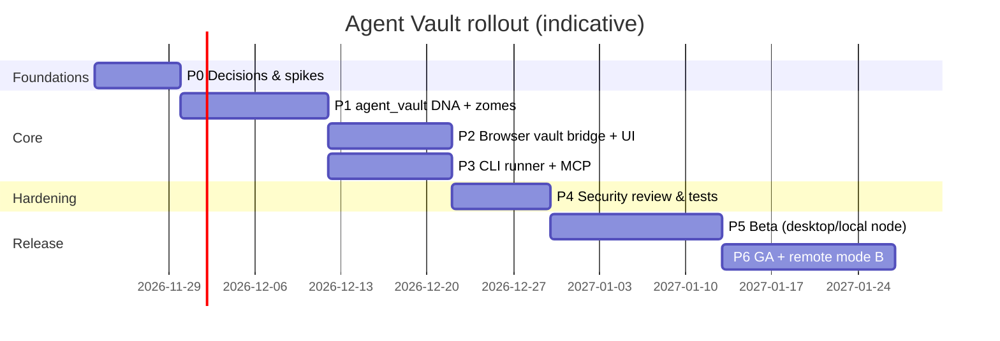

# Filenymous Agent Vault — Deployment plan

> **Progress (2026-11-15):** Phases 1–3 are implemented in v1 (branch `feat/agent-vault`), with the defaults below
> chosen for Phase 0: local conductor + owner node online; `agent_vault` DNA shipped as a **separate installed app** (`filenymous-agent-vault`, installed by the desktop shell on launch if missing); denied fetches audited;
> TypeScript CLI runner only (no Rust runner yet). Phases 4–6 remain. See ARCHITECTURE.md §0.1.

> **Original status: provisional.** The brief said "analyse the working documents and, if OK, write a deployment plan".
> The attached files (27 KB `.md`, 11 KB `.svg`) were **not on the build box**, so they have **not** been reviewed.
> This plan follows [`ARCHITECTURE.md`](ARCHITECTURE.md), which is built from the repo (`main` @ `1fd53bf`), so it is
> consistent with the code as it is. Before anyone starts Phase 1, run the checklist in ARCHITECTURE.md §9 against the
> working documents and reconcile any differences.

Baseline: Holochain 0.6.1 / HDK 0.6.1 / HDI 0.7.1 (`Cargo.toml`, `flake.nix` holonix `main-0.6`), `@holochain/client`
^0.20.5, Rust `holochain_client` 0.8.1 (`src-tauri/Cargo.toml`), Tryorama ^0.19.2 (`tests/package.json`).
Estimates assume one experienced developer and are for planning only.

## Overview

## Phase 0 — Decisions & spikes (≈1 week)

| # | Task | Output / exit criteria |
|---|---|---|
| 0.1 | Reconcile the working documents with ARCHITECTURE.md §9 | List of agreed changes; doc v2 |
| 0.2 | Decide DNA strategy: **separate DNA + separate installed app** (chosen) vs. adding zomes to `filenymous` DNA (forks `filenymous-mainnet-v2`) | ADR committed under `docs/` |
| 0.3 | Spike: in-zome `create_cap_grant(Assigned)` + client-signed zome call from a separate Node process using `@holochain/client` 0.20 signing credentials on HC 0.6.1 | Passing throwaway Tryorama test |
| 0.4 | Spike: `fetch_bundle` denial persistence (return `Ok(Denied)` vs `Err` rollback) | Decision recorded |
| 0.5 | Confirm whether Holo Web Conductor can host grants for external callers (expected: no) | Product copy: "requires desktop/local node" |
| 0.6 | Fix existing validation gaps (Delete/DeleteLink in `identity_integrity`, `parcel_integrity`) — can ship independently | PR + Tryorama test |

Dependencies: none. Risk gate: if 0.3 fails on 0.6.1, either use admin-side `grant_zome_call_capability` (owner app only)
or plan the HC 0.7 upgrade first (then `holochain_client` 0.9.x).

## Phase 1 — `agent_vault` DNA and zomes (≈2–2.5 weeks)

| # | Task | Files |
|---|---|---|
| 1.1 | Scaffold `dnas/agent_vault/dna.yaml` (own `network_seed`), own `happ.yaml` → separate installed app `filenymous-agent-vault` (done in v1) | `happ.yaml`, `web-happ.yaml`, `dnas/agent_vault/` |
| 1.2 | Integrity zome: private entry types `AgentConfig`, `SealedBundle`, `AgentToken`, `TokenRevocation`, `AccessEvent`; validation (TTL ≤ 30 d, sizes, append-only, `agent_key != author`) | `dnas/agent_vault/zomes/integrity/agent_vault_integrity/` |
| 1.3 | Coordinator: `create_agent_config`, `list_agent_configs`, `issue_agent_token`, `rotate_config_bundle`, `revoke_agent_token`, `list_agent_tokens`, `list_access_events`, `export_audit`, `fetch_bundle`, `token_status` | `dnas/agent_vault/zomes/coordinator/agent_vault/` |
| 1.4 | Workspace + build: `Cargo.toml` members, `Makefile` targets, CI build of the new WASM / `.happ` | `Cargo.toml`, `Makefile`, `.github/workflows/*` |
| 1.5 | Rust unit tests for validation (pure functions) | same crates |
| 1.6 | **Tryorama** scenarios (`tests/src/agent_vault.test.ts`): owner issues → runner fetches → TTL expiry → `max_uses` → revoke → wrong agent key → wrong token tag → `Transferable` secret replay without signature fails → update/delete of `AccessEvent` invalid → private entries not retrievable by a 2nd player via `get` | `tests/src/` |
| 1.7 | Optional: **Sweettest** (Rust, `holochain` crate with `test_utils`) for conductor-level cap checks and clock control | `tests/sweettest/` (new) |

Exit: all tests green in CI on holonix `main-0.6`.

## Phase 2 — Browser vault bridge and UI (≈2 weeks, after P1)

| # | Task | Files |
|---|---|---|
| 2.1 | Parameterise role in client (`ROLE` constant) and add `agentVault.ts` typed wrappers | `ui/src/holochain/client.ts`, `ui/src/holochain/agentVault.ts` |
| 2.2 | `agent_configs` encrypted table + migration | `ui/src/safe/repo.ts`, `repo.test.ts` |
| 2.3 | `sealBundle()` (X25519 eph + HKDF + AES-256-GCM, AAD binding) + tests incl. tamper cases | `ui/src/safe/crypto.ts`, `crypto.test.ts` |
| 2.4 | Worker RPCs `agents.*` (plaintext stays in worker) | `ui/src/safe/safe.worker.ts`, `client.ts` |
| 2.5 | `SafeAgents.tsx`: configs, enroll, issue (TTL, max uses), token list, revoke, rotate, audit timeline, export | `ui/src/safe/SafeAgents.tsx`, `SafePanel.tsx` |
| 2.6 | i18n FR/EN, copy on limits (owner node online, revocation ≠ un-leak) | `ui/src/i18n/locales/*.json` |
| 2.7 | Vitest units + Playwright e2e (`ui/e2e/safe-agents.spec.ts`) against a local conductor | `ui/e2e/` |

## Phase 3 — CLI runner and read-only MCP (≈2 weeks, parallel with P2)

| # | Task | Files |
|---|---|---|
| 3.1 | `filenymous vault enroll` (keys in OS keychain or `--ephemeral`) | `cli/src/vault.ts`, `cli/src/cli.ts` |
| 3.2 | `filenymous vault run -- <cmd>`: connect, fetch, open, spawn with env, zeroize, no disk writes | `cli/src/vault.ts` |
| 3.3 | `filenymous vault status`, `filenymous vault mcp` (names/status only; no values) | `cli/src/vault.ts` |
| 3.4 | Tests: unit + loopback with a real conductor; MCP test asserting no tool output contains bundle plaintext | `cli/test/vault.test.mjs` |
| 3.5 | Docs: Claude Code / Cursor / Codex snippets (`"command": "npx", "args": ["-y","filenymous@x.y","vault","run",…]`) | `cli/README.md`, `README.md` |
| 3.6 | Optional native runner in `src-tauri` using `holochain_client` 0.8.1 | `src-tauri/src/` |

## Phase 4 — Security hardening (≈1.5 weeks)

* Threat-model review (STRIDE) of ARCHITECTURE.md §7; update `docs/VAULT.md` and `docs/SECURITY_MODEL.md`.
* Fuzz/property tests on validation and sealed-box parsing.
* Negative tests: clock skew, replay of an old cap secret after revoke, grant/tag mismatch, oversized bundles, chain bloat
  (rate-limit fetches; runner caches for process lifetime).
* External review of crypto glue (sealBundle / open) — recommended before GA.
* Secret-leak guards in runner: refuse `--` commands that echo env (best effort), redact in logs, `FNY_*` env never logged.

## Phase 5 — Beta (≈2 weeks)

* Target: Filenymous desktop (Tauri) and `?node=local` users only (`websocket` mode); UI hidden in `holo-web` / `web-bridge`.
* Feature flag `VITE_AGENT_VAULT=1`; staged release of CLI as `filenymous@next`.
* Infra: **no new server**. Signaling relay unchanged. Optional "always-on vault node" guide (headless conductor on a
  user-owned box) for CI usage.
* Telemetry: none by default (privacy promise); opt-in local diagnostics only.
* Exit criteria: ≥ 10 beta users, zero plaintext found in conductor DB dumps / DHT, revoke latency < 1 s locally.

## Phase 6 — GA and Mode B (remote agents) (≈2 weeks)

* Remote agent conductor + `call_remote` with `Assigned` grant to its `AgentPubKey`; in-zome decryption via
  `x_25519_x_salsa20_poly1305_decrypt` (lair) on the agent side.
* Public docs page update (`ui/seo/content.mjs`, `fonctionnalites/coffre-fort-p2p`), changelog, npm release
  (`cli/package.json`), `.webhapp` release.
* Optional v2: offline delivery mailbox (already listed as a follow-up in `docs/VAULT.md`), audit checkpoints published
  to DHT (head hash only), countersigned receipts when HDK countersigning leaves `unstable`.

## Testing matrix

| Layer | Tool | Where |
|---|---|---|
| Validation logic | `cargo test` | integrity crate |
| Zome behaviour, multi-agent, caps | **Tryorama** ^0.19 (+ `dhtSync`) | `tests/src/agent_vault.test.ts` |
| Conductor-level / clock | **Sweettest** (Rust) | `tests/sweettest/` |
| Browser crypto / repo | Vitest | `ui/src/safe/*.test.ts` |
| UI flows | Playwright | `ui/e2e/safe-agents.spec.ts` |
| CLI + MCP | node test | `cli/test/vault.test.mjs` |

## Risks

| Risk | Impact | Mitigation |
|---|---|---|
| Owner node offline → agent can't start | High for CI | Always-on vault node guide; runner retries; clear error |
| Network fork if zomes added to existing DNA | High | Separate role/DNA (P0.2) |
| HC version drift (docs show client 0.9 / HC 0.7) | Medium | Pin 0.6.x stack; plan upgrade as a separate project |
| Agent leaks secret into prompt/logs | High, inherent | Short TTL, minimal scope, rotation prompts, warning copy (as for Sharewall agents) |
| Cap secret exposure | Low (Assigned + sealed bundle) | Never `Transferable`; revoke + reissue |
| Chain bloat from AccessEvent per fetch | Low/Medium | Fetch once per process; rate-limit |
| HWC users expect the feature | Medium | Gate UI by runtime mode; explain why |
| Working documents diverge from this plan | Unknown | P0.1 reconciliation before coding |
